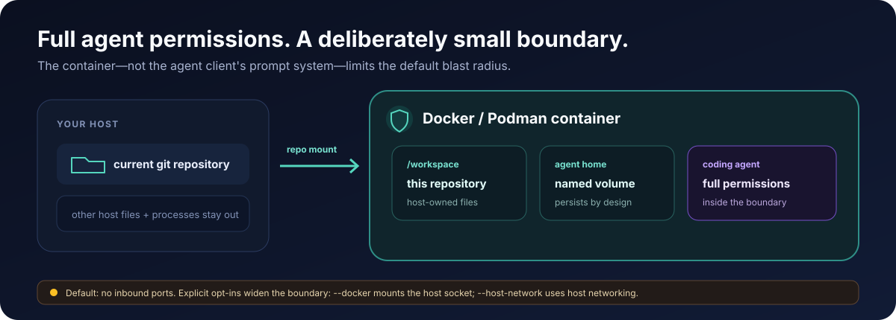

# Security

## Threat model

**The container is the security boundary.** [`cenci-sandbox`](./sandbox) runs Claude
Code with `--dangerously-skip-permissions` and Codex with
`--dangerously-bypass-approvals-and-sandbox` — both agents run fully unattended, with no
per-command approval prompts. That's only safe because isolation moves from the agent's
own permission system to the container: the agent can do anything *inside* the
container, but the container is what stands between it and your host. See
[`sandbox/CLAUDE.md`](./sandbox/CLAUDE.md) and
[`sandbox/README.md`](./sandbox/README.md#permission-model) for the full model.



### What the sandbox protects against

- Arbitrary file writes/deletes outside the mounted repo — only the current repo's root
  is mounted at `/workspace` (not your whole `~/Repos`), and the container has its own
  home directory backed by a named volume, not your host `~/`.
- Host process/credential access — the agent cannot see host processes, host
  environment variables (beyond what's explicitly forwarded), or host files outside the
  mount points documented in the [sandbox README](./sandbox/README.md#what-persists-home-volume).
- Inbound network exposure — by default the container runs in its own separate network
  namespace (bridge mode) and publishes no inbound ports, so nothing on your host or
  network can initiate a connection into the container. This is a "no published inbound
  ports" guarantee, not a claim of complete outbound-only isolation: outbound connections
  initiated from inside the container may still reach routable host, LAN, or internet
  services, depending on your container runtime and firewall configuration.

### What it does NOT protect against

- **Anything the mounted repo's build/test/tooling can do on your behalf inside the
  container** — e.g. a malicious `package.json` script or Makefile target run by the
  agent still executes with full container privileges. The container boundary limits
  *blast radius to the container*, not what happens within it.
- **Supply-chain risk in what you mount or install** — the sandbox doesn't vet
  dependencies, MCP servers, or plugins you add. `watch` release tarballs themselves
  carry a SLSA build provenance attestation you can verify — see
  [watch/README.md#verifying-release-provenance](./watch/README.md#verifying-release-provenance).
- **The opt-in flag below**, which deliberately widens the boundary.

### Opt-in weakenings

Off by default and must be explicitly requested per-launch:

- **`--host-network`** — switches the container to host networking, needed for OAuth
  flows that require a browser callback to `localhost`. The container joins a *shared*
  host network namespace instead of its own isolated bridge namespace: it loses network
  namespace separation from the host for the life of that session, and any port the
  container binds to `localhost` is reachable exactly as if that process were running
  directly on your host — the increased blast radius is the same for the life of the
  session regardless of which process inside the container opens the port. Prefer the
  default (bridged) network and only reach for `--host-network` when a login flow fails
  without it. `cenci audit`/`cenci security explain` report this weakening automatically
  whenever a running scoped container was actually launched with host networking — even
  if the current invocation didn't pass `--host-network` — see
  [watch/README.md](./watch/README.md#effective-security-posture-cenci-audit). A louder, more visible
  warning when this flag is used is tracked in
  [#148](https://github.com/matteobortolazzo/cenci/issues/148) (not yet landed).

### Nested Docker (`--dind`) preserves the boundary

`--dind` (or a repo's `sandbox.dind` config) — nested Docker for TestContainers,
`docker build`, and similar — is opt-in but, unlike the retired `--docker`
Docker-outside-of-Docker flag it replaces, does **not** weaken the container boundary. The
inner `dockerd` runs *inside* the sandbox container, isolated by the sysbox-runc OCI
runtime, backed by its own dedicated `*-cenci-dind-*` storage volume — it never talks to
the host's Docker daemon or socket. A container started with `docker` inside a dind
sandbox stays inside that sandbox; it does not run on the host. This guarantee relies on
sysbox's user-namespace isolation, not on a separately virtualized kernel: the inner
daemon still shares the same host kernel as the rest of the sandbox, so dind adds an
inner daemon and a shared-kernel attack surface compared to a sandbox with no Docker at
all — which is why dind stays opt-in; only enable it for repos that genuinely need
in-container Docker. See
[sandbox/README.md#nested-docker-sysbox](./sandbox/README.md#nested-docker-sysbox).

The dedicated `*-cenci-dind-*` storage volume backing a dind session holds the inner
Docker's own image/container layers, build caches, and any data those in-container images
or containers write — potentially sensitive application/build state, the same way the
credential-bearing home volume is. Remove it the same way credentials are removed above
once you no longer need it:

```bash
docker volume rm claude-cenci-dind-<repo-slug>
# or, for Codex sessions:
docker volume rm codex-cenci-dind-<repo-slug>
```

`cenci sandbox prune --volumes` and full `install.sh uninstall` both inventory and offer
to remove these volumes alongside the credential-bearing home volumes.

### Credentials

Host credentials (`~/.claude/.credentials.json`, `~/.codex/auth.json`,
`~/.config/gh/hosts.yml`) are bind-mounted read-only into a staging path and copied into
the container's **named home volume** on first start — not baked into any image layer.
That volume persists across container restarts (by design, so you don't re-auth every
session) but also means copied credentials live on disk in the volume until you remove
it.

To remove a volume and everything copied into it:

```bash
docker volume rm claude-cenci-home-<repo-slug>
# or, for Codex sessions:
docker volume rm codex-cenci-home-<repo-slug>
```

See [sandbox/README.md#reset-an-instance](./sandbox/README.md#reset-an-instance)
for the full naming scheme (per-repo slug, `--name` suffix, legacy `-default` volumes).
`cenci sandbox prune` removes superseded base tags, dangling images, and stopped sandbox
containers. Add `--volumes` to list credential-bearing home volumes separately from
the shared `cenci-agent-cli-claude` / `cenci-agent-cli-codex` executable volumes and
interactively confirm their removal. Volume deletion defaults to no because removing a
home destroys copied credentials and session history; shared CLI volumes contain no
credentials and are recreated by verified bootstrap on the next launch.

The shared `cenci-agent-cli-*` volumes are host-global, not per-repo or per-instance:
`cenci sandbox update-agent` (including a pinned or downgraded `--version`) mutates the
one volume every sandbox on the host mounts read-only, so an update or rollback in one
repo's context affects every other repository's sessions too. See [sandbox/README.md
under Update an agent
CLI](./sandbox/README.md#update-an-agent-cli) for the activation and retention model.

### Claude Code mods and plugin guards

This subsection applies to **Claude Code mods only**. It makes no claim about Codex or
OpenCode. A Claude Code mod is a plugin made of JavaScript or TypeScript event handlers
that run inside the Claude Code client with your OS permissions; mods are not sandboxed
([overview](https://code.claude.com/docs/en/plugins/mods/overview)). cenci's own guards are
ordinary plugin hooks, so how they relate to an installed mod depends on three layers:

1. **Ordinary plugin and settings `PreToolUse` hooks** — cenci's
   `flow/hooks/scripts/check-sensitive-files.sh` and
   `flow/hooks/scripts/guard-main-worktree.sh`. They constrain Claude's own tool calls
   (`Write`, `Edit`, Bash) as workflow safeguards. They do not constrain another installed
   mod: a mod can approve past them or answer the call before they run, as described below.
2. **Managed-settings hooks and the built-in `sec-default@builtin` guard policy** —
   administrator-controlled, and cenci deploys none of it. The guard loads under managed
   settings, or by default on a Team or Enterprise login (see below). Managed hooks run
   before any mod, and where the guard loads it stops a user's mod from approving calls
   that a deny rule or a `PreToolUse` hook refused. It constrains mods only while it is loaded and
   configured as described below. It does not constrain a mod's own file or process calls,
   and the official documentation does not describe it as stopping a mod from answering a
   call itself (see (b) below).
3. **The outer Docker/Podman container** — the isolation boundary for a Claude process
   launched inside it. It constrains everything that runs in that process, mods included,
   to what the container can reach. It does not constrain what is reachable inside the
   container.

**Ordering** ([events](https://code.claude.com/docs/en/plugins/mods/events#the-order-mods-run-in)):

- Managed-settings `PreToolUse` hooks run before any mod's `tool.call` hook.
- When a managed hook blocks a call, no mod `tool.call` hook runs for it.
- If a mod rewrites a call that then goes ahead, the managed hooks run again on the
  rewritten call. The official documentation does not describe a second, separate check by
  plugin hooks, and this page does not claim one.
- `PreToolUse` hooks from other settings files and from plugins, where cenci's guards
  live, run after the last mod.
- `tool.check` runs after `tool.call` and `PreToolUse` and can return `allow`, `ask` or
  `deny`.

**What a mod can do to the cenci guards:**

- (a) A mod's `tool.call` hook can approve a call that a non-managed `PreToolUse` hook
  blocked, when the built-in guard is not loaded or when managed
  `allowModsToOverrideDenyRules` is `true`.
- (b) A mod that answers a tool call itself, by returning a result or a denial without
  passing the call on, stops the tool and keeps the plugin and settings `PreToolUse` hooks
  from running at all.
- (c) A mod's own `$.fs` and `$.process` calls are not checked by tool permission rules or
  by `PreToolUse` hooks. A deny rule that holds for a Claude tool call does not constrain
  them: with `Read(.env)` denied, a mod can still read that file with `$.fs.read`, or start
  a program that does
  ([overview](https://code.claude.com/docs/en/plugins/mods/overview)).

**When `sec-default@builtin` loads**
([admin](https://code.claude.com/docs/en/plugins/mods/admin#know-what-happens-by-default)):

- It loads when the machine has managed settings, or when the session runs on `/login`
  credentials for a Team or Enterprise plan.
- API-key, Bedrock, Google Cloud Agent Platform and Microsoft Foundry sessions get it only
  on a machine with managed settings. A session using `CLAUDE_CODE_OAUTH_TOKEN` does not
  count as that login.
- If managed `prependPlugins` is set, it loads only when the list names the guard. A list
  that leaves it out, including `"prependPlugins": []`, removes the guard, and its
  precedence for deny rules and `PreToolUse` hooks is then absent.
- While it is loaded, a user's mod cannot approve a call that a deny rule refused or an
  `ask` rule prompts for, nor one that a `PreToolUse` hook blocked, unless managed
  `allowModsToOverrideDenyRules` is `true`. With that option set, deny rules no longer
  take precedence over a user's mod.
- cenci containers ship no managed settings. Inside `cn`, the guard is therefore present
  only when the login copied into the container is a Team or Enterprise plan; with an API
  key or any other credential it is absent, and the cenci guards are ordinary hooks a mod
  can approve past.
- The official documentation does not describe the guard as stopping a mod from answering
  a call itself, so this page does not assume it does. Treat the cenci plugin hooks as
  skippable by a mod even where the guard is loaded, as in (b) above.

**Container-run Claude.** `cn`, `cenci open`, and `cenci open --shell` running plain
`claude` inside the container are all container-run. A process that a mod starts is
outside Claude Code's built-in Bash sandbox, which is already disabled inside `cn` (see
[`sandbox/AGENTS.md`](./sandbox/AGENTS.md)), but it is inside cenci's container, running as
the `dev` user (remapped to your host UID/GID). What it can reach is defined by the
sections above and below, not by Claude Code's permission system: the `/workspace` mount
and the home volume
([sandbox README](./sandbox/README.md#what-persists-home-volume), including the
[read-only mounts](./sandbox/README.md#whats-bind-mounted-read-only)), the forwarded
credentials (the `/tmp/host-claude-creds` staging path, its copy in the home volume that
Claude uses, the `gh` hosts file, and environment-forwarded keys such as
`ANTHROPIC_API_KEY` and `OPENAI_API_KEY` when set, and `CONTEXT7_API_KEY`; see
[Credentials](#credentials) and the
[sandbox README](./sandbox/README.md#what-persists-home-volume) for the full list), and the
network mode and opt-in options. The default bridge network still allows outbound
connections, so a mod can send any credential it can read off the machine. `--host-network`
widens what a mod-started process can reach on the network
([Opt-in weakenings](#opt-in-weakenings)); `--dind` adds an inner daemon and shared-kernel
attack surface but keeps the boundary
([Nested Docker preserves the boundary](#nested-docker---dind-preserves-the-boundary)).
Writes a mod makes under `/workspace` persist on the host and can run there later, outside
the container: `.git/hooks`, `.git/config` (for example `core.hooksPath`),
`.claude/settings.json`, `.mcp.json` and build scripts. `git diff` shows the tracked files
but not `.git/` contents, so after a session that ran an untrusted mod, inspect `.git/hooks`
and `.git/config` directly, or re-clone, before running git or Claude on the host. Writes
to the home volume persist across later `cn` sessions for that repo, so remove the volume
to reset it (see [Credentials](#credentials)).

**Host-run Claude.** When cenci's plugins are installed in Claude Code running directly
on the host, a mod runs with the host user's OS permissions and no cenci container applies.
The two guards are the same ordinary plugin hooks described above.

**Trusted-mod guidance:**

- Install mods only from authors and marketplaces you trust
  ([overview](https://code.claude.com/docs/en/plugins/mods/overview#decide-whether-to-trust-a-mod)).
- Treat mod code as code running with your permissions, and review a mod's declared
  hooks and calls before you install it.
- Prefer running mod-using sessions inside `cn`, so the container bounds what they can
  reach (writes under `/workspace` still land on the host).
- An administrator can stop user-installed mods from loading with the guard's
  `allowManagedModsOnly` option
  ([admin](https://code.claude.com/docs/en/plugins/mods/admin#stop-user-installed-mods-from-loading));
  it is set in managed settings and has no effect from a user, project or local settings file.
- cenci deploys no managed settings, no `disableAllHooks` and no mod allowlist.

For the full event and API surface see the official
[reference](https://code.claude.com/docs/en/plugins/mods/reference).

Observed as of November 2026 (documentation read, nothing tested), in a `cn` session
running Claude Code 2.1.319. That version
comes from the session's `AI_AGENT` environment marker, because the `claude` binary was
not on the shell's `PATH` and `claude --version` could not be run. The behavior described
here comes from the official pages, which say mods require Claude Code v2.1.287 or later and
document behavior as of v2.1.290. No mod was installed in that session to test whether the
guard is present, so its load conditions inside `cn` are read from those pages, not tested.
Re-verify after any Claude Code upgrade.

## Release artifact integrity

`cenci-watch` release checksums are signed keylessly via Sigstore/cosign (GitHub
Actions OIDC, published to the public Rekor transparency log) — see
[Verifying release artifacts](./watch/README.md#verifying-release-artifacts) for the
`cosign verify-blob` command and the follow-through `sha256sum -c` check.

## Reporting a vulnerability

Email **matteobortolazzo@pm.me** with details — this is the reliable channel today.
Please include:

- Which layer/plugin is affected (cenci, cenci-watch, cenci-sandbox)
- Steps to reproduce, and the impact you believe it has
- Whether the issue is exploitable from outside the container boundary described above,
  or only from within an already-fully-privileged agent session

GitHub's private vulnerability reporting will be enabled for this repository as part of
ongoing public-release hygiene work; once it is, that becomes the preferred channel and
this section will be updated accordingly. Until then, email is the dependable path — please
do not open a public issue for a suspected vulnerability.
