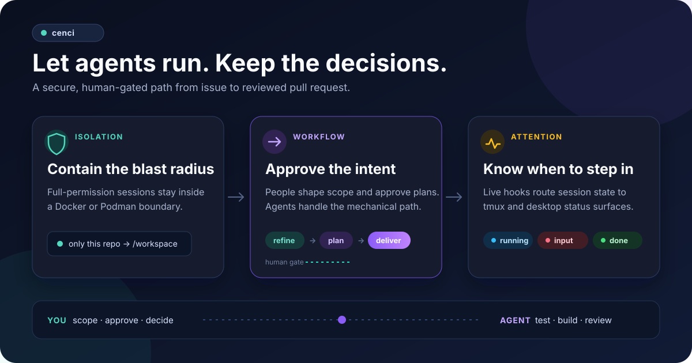
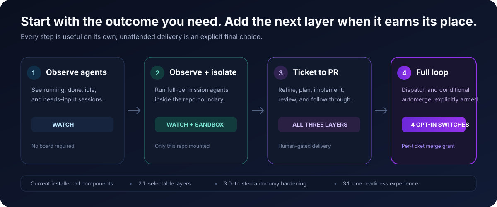
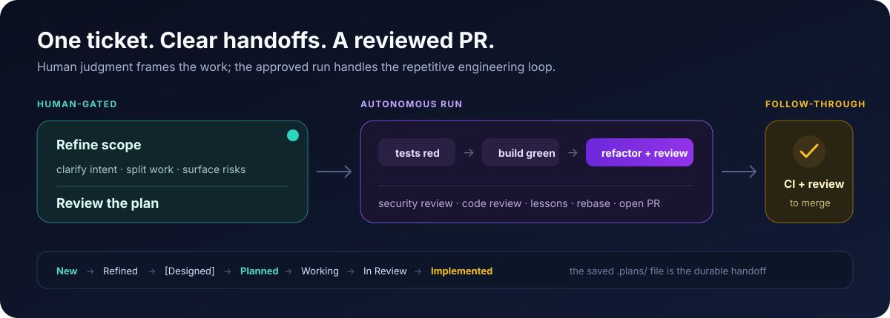
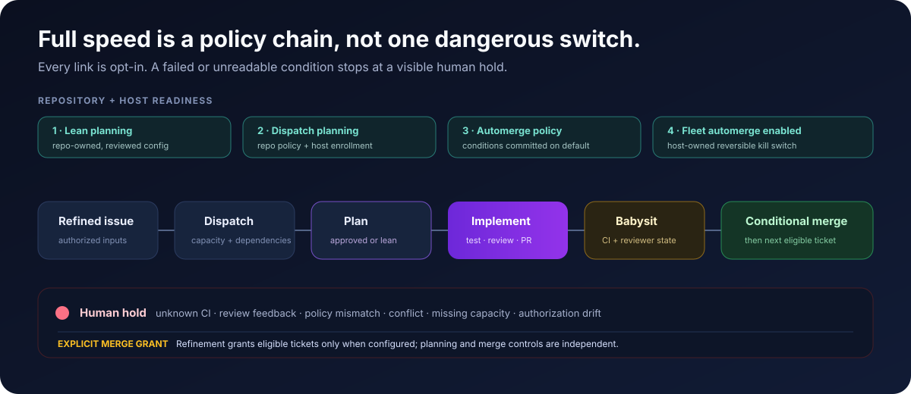

# Getting started

This is the detailed companion to the [README quickstart](../README.md#quickstart) —
use it for prerequisite detail, verification, troubleshooting, and
recovery/standalone installs. Start with the outcome you want, then follow the shared
install → verify → launch path. cenci is one product; the installer currently manages
its three internal components for every supported client it detects.



## Choose an outcome



| Outcome | Layers | Continue with |
|---|---|---|
| Observe agent sessions | Watch | [Launch](#4-launch), then the [status surfaces](../watch/README.md) |
| Observe and isolate | Watch + Sandbox | [Launch](#4-launch), then the [sandbox guide](../sandbox/README.md) |
| Take a GitHub ticket to a reviewed PR | All three | [Configure](#5-configure-a-project), then [run a ticket](#7-run-a-ticket) |
| Run dispatch through conditional automerge | All three + four opt-in switches | Finish the gated path first, then read [the autonomous loop](autonomous-loop.md) |

The installer does not offer component selection yet: it reconciles all three and you
use only the layers you need. Selective installation is tracked in
[#938](https://github.com/matteobortolazzo/cenci/issues/938) and sequenced in milestone
[2.1 — Selective setup](https://github.com/matteobortolazzo/cenci/milestone/2).

## 1. Prerequisites

Install:

- Linux, macOS, or WSL2
- git
- curl
- jq
- [cosign](https://docs.sigstore.dev/system_config/installation/)
- Docker or Podman
- Claude Code, Codex, or both

Claude Code is required for the complete interactive ticket-to-PR workflow. A
Codex-only installation still provides container isolation, monitoring, portable
engineering conventions, and the [Codex implementation recipe](../flow/docs/codex.md).

[OpenCode](../flow/docs/opencode.md) is temporarily disabled. See
[OpenCode support](#opencode-support-additional-opt-in-agent) below.

Optional features have separate dependencies:

| Feature | Dependency |
|---|---|
| GitHub issues and PRs | [GitHub CLI](https://cli.github.com) authenticated with `gh auth login` |
| tmux status | tmux |
| macOS menu-bar status | [SwiftBar](https://swiftbar.app) |
| desktop status | One of the documented cenci display widgets |

## 2. Install

Run one command:

```bash
curl -fsSL https://raw.githubusercontent.com/matteobortolazzo/cenci/main/install.sh | bash
```

The bootstrap downloads the latest release's installer and signature bundle,
verifies them with cosign, then runs the verified installer. Verification failure
stops installation. The initial bootstrap itself is fetched over HTTPS from main.

### Optional: verify before executing any downloaded script

If you prefer to verify the installer before running even the bootstrap, use:

```bash
curl -fsSL -o install.sh https://github.com/matteobortolazzo/cenci/releases/latest/download/install.sh
curl -fsSL -o install.sh.bundle https://github.com/matteobortolazzo/cenci/releases/latest/download/install.sh.bundle
cosign verify-blob --bundle install.sh.bundle \
  --certificate-identity-regexp '^https://github\.com/matteobortolazzo/cenci/\.github/workflows/watch-release\.yml@refs/(heads/main|tags/watch/v[0-9]+\.[0-9]+\.[0-9]+)$' \
  --certificate-oidc-issuer 'https://token.actions.githubusercontent.com' \
  install.sh
bash install.sh
```

Requires [cosign](https://docs.sigstore.dev/system_config/installation/) — the last
`cosign verify-blob` step checks the downloaded `install.sh` against cenci's pinned
release identity before it runs; verification fails closed, with no fallback to an
unverified ref.

Resolves to the latest release tag by default. That resolved ref pins the client
marketplace manifests and all three plugins' content — not just which install.sh
runs — for every install, update, and repair run. Set `CENCI_REF=main` (or pass
`--ref main`) to explicitly opt into bleeding-edge, unverified main instead (unsafe;
development use only) — it is the only path that intentionally tracks main.

From a clone, run `./install.sh`. Non-interactive automation can add `--yes`; use
`./install.sh --help` for the complete public interface. Every run reconciles the
cenci marketplace and the three components (`cenci`, `cenci-watch`, and
`cenci-sandbox`) for each detected client: it adds missing pieces and refreshes
existing ones. It then puts the `cenci` binary and its `cn` launch alias on your PATH.

## 3. Verify

`doctor` changes nothing and separates required platform dependencies, detected
clients, optional feature dependencies, installed components, launchers, and image
readiness:

```bash
cenci doctor
```

Warnings for optional features are safe to defer. Fix any required item marked with
`✗` before continuing.

## 4. Launch

```bash
cn           # Claude Code
cn xt        # Codex (or: cn --agent codex)
```

Run this from a git repository — only that repository root is mounted at
`/workspace`. cenci-watch needs no separate binary install: the first supported
client session provisions it and starts the shared host daemon.

Codex reads the repository's canonical `AGENTS.md` guidance directly. Generated
`CLAUDE.md` files are client adapters, not the shared source of truth.

If Codex reports updated plugin hooks as pending, inspect and trust them with `/hooks`.

## 5. Configure a project

In a sandboxed Claude Code session, run once:

```text
/cenci:configure
```

This detects the stack, writes project guidance, configures workflow metadata, and can
generate a reviewed per-repository sandbox image definition. Codex-only users follow
the [portable project and implementation guidance](../flow/docs/codex.md); the
interactive configure skill is Claude Code-only. See
[flow/README.md's "What `/cenci:configure` creates"](../flow/README.md#what-cenciconfigure-creates)
for the generated file layout, including the monorepo progressive-disclosure structure.

## 6. Keep the project healthy

cenci's maintenance checks are a core workflow feature, not a lazyboards add-on — they
work the same whether or not you ever set up a board.

Every `/cenci:implement` run already automatically checks documentation and generated
indexes affected by the files it changes, and repairs or reports what it finds — no
setup required. Optional `.cenci/config.json` controls change the policy without
disabling correctness: `checkDuringImplement: false` keeps the check report-only,
including CI-blocking `fail` results, which disables the Phase 9 push gate,
`generatedDocs: false` skips marker-bounded generated-section maintenance, and
`maintenance.enabled` controls only scheduled/reminder UX.

To limit implement runs to required documentation work, see [flow/README.md's documentation policy](../flow/README.md#documentation-policy).

For a full, on-demand audit of the whole project — workflow structure, docs, client
adapters (Claude Code, Codex, OpenCode), and accumulated rules — run:

```text
/cenci:maintain
```

It reports findings with proposed repairs and opens a PR with the cleanup once you
approve. See [flow/README.md's maintenance section](../flow/README.md#maintaining-the-project)
for each mode (`structure`, `docs`, `clients`, `rules`).

## 7. Run a ticket

```text
/cenci:refine 42
/cenci:implement 42
/cenci:babysit <pr-number>
```

After implementation opens the PR, `babysit` checks CI and review feedback
immediately, then schedules progressively quieter checks until the PR merges or
closes. It can fix actionable failures and comments while preserving approval gates;
on merge it performs the final `In Review → Implemented` transition. The persistent
supervisor supports both Claude Code and Codex. See
[Babysitting a PR](../flow/README.md#babysitting-a-pr) for pacing and safety details.

The lifecycle is always:



For UI work, refinement can branch through a dedicated design ticket. Planning saves
an approved `.plans/` file and applies `Planned`; implementation or automated dispatch
(`cenci dispatch`) picks it up and applies the transient `Working` state. PR creation
applies `In Review`, and merge completion applies `Implemented`.

## 8. Optional: remove the gates



Everything above keeps you in the loop at refinement, at plan review, and at merge.
Four opt-in switches remove those gates one at a time — up to a chain that runs
refine → plan → implement → PR → merge → next ticket unattended. All four are off by
default, per-repo autonomy is committed to the repo (so the repo decides), and the
per-ticket merge grant stays a human decision.

[The autonomous loop](autonomous-loop.md) has the switch table, a quick start with
working config for both `~/.config/cenci/config.json` and the repo's
`.cenci/config.json`, what still stops the machine, and how to read a held-merge log
line. Treat it as an advanced opt-in while the [3.0 Trusted autonomy
milestone](https://github.com/matteobortolazzo/cenci/milestone/9) closes the remaining
correctness and authorization gaps.

## Selective adoption

Want the isolation and attention layers on a repo that doesn't use the gated pipeline?
[Selective adoption](selective-adoption.md) covers the per-repo disable recipe, what you
lose and how to replace it, and the residual gaps that have no mitigation.

## OpenCode support (additional, opt-in agent)

OpenCode is temporarily disabled. The installer detects it and reports the pause,
but does not offer setup, link skills, or modify its configuration. Direct sessions,
workflow runs (including user templates), dispatch, babysit, and explicit agent/plugin
updates refuse; bulk updates skip OpenCode.

Existing host settings, credentials, containers, and volumes remain intact.
`cenci doctor` reports the pause and can inspect legacy registration/authentication.
Diagnosis, stopping, and cleanup remain available; `cenci uninstall` can remove
cenci-owned skill symlinks and plugin registration while preserving other settings.

OpenCode-only fixes and scope extracted from shared tickets are parked in the
[owner-opt-in milestone](https://github.com/matteobortolazzo/cenci/milestone/18),
with no due date. Re-enablement is tracked by
[#1222](https://github.com/matteobortolazzo/cenci/issues/1222) and requires an explicit
owner decision. Shared Claude/Codex work continues in its existing milestones.

## Update

```bash
cenci update
```

The command refreshes the cenci marketplace through the owning client, then reconciles
all three components in every detected client — missing pieces are added and existing
ones are refreshed. It resolves the active cenci-watch cache, refreshes launchers, and
replaces a stale running cenci daemon with the updated binary. Use
`cenci update --lazyboards` to install or reconcile the optional board binary; an
already-managed lazyboards installation is also refreshed by a normal update.

The host binary follows the active installed cenci-watch version, ignoring older
cache timestamps. If both clients are installed, it uses the newer active version.
If that binary cannot be provisioned, an available older binary remains usable,
but the update exits nonzero and reports that the binary update is incomplete.
Check the bootstrap log (`${TMPDIR:-/tmp}/cenci-bootstrap.log`) and retry
`cenci update`. Restart agent sessions to load updated plugins.

The components version independently. In particular, a `watch/v0.5.4` release is the
`cenci-watch` plugin release, so update output correctly reports it on the
`cenci-watch` line rather than the `cenci` workflow-plugin line.

`cenci update` now requires `cosign` to be installed — it downloads and verifies a
fresh installer before applying it, the same fail-closed check that piped installs have
always used. If cosign is missing, `cenci update` stops with an actionable message
instead of silently falling back to the currently-installed (possibly stale) installer;
`cenci doctor` reports this as a hard failure rather than a warning.

### Troubleshooting: `cenci update` reports success but the version never changes

Older installations can run a stale local updater or select an old cached binary.
Rerun the current installer to repair the installation using the latest release:

```bash
curl -fsSL https://raw.githubusercontent.com/matteobortolazzo/cenci/main/install.sh | bash
cenci --version
cenci doctor
```

This detects Claude Code and Codex automatically. Compare `cenci --version` with
the installer's **cenci-watch** version; the workflow and sandbox components have
independent version numbers. An unchanged version can also mean you already have
the latest published release. Updates use that release's snapshot of all three
components; changes on main reach this channel when a new Watch release is published.

## Uninstall

```bash
cenci uninstall
```

The command removes installed plugins, `PATH` links, the daemon, and config by
delegating to the managed `cenci-installer uninstall` wrapper. `cenci uninstall`
takes no flags or arguments; destructive flags like `--yes` and `--lazyboards`
require invoking `cenci-installer uninstall` directly.

## Troubleshooting

| Symptom | Resolution |
|---|---|
| Neither client is detected | Install Claude Code, Codex, or both, then rerun the installer |
| `cenci` or `cn` is not found | Add `~/.local/bin` to `PATH`, then rerun the install command |
| cenci status has not appeared | Start a new agent session and inspect `${TMPDIR:-/tmp}/cenci-bootstrap.log` |
| Codex skills are missing | Confirm `codex plugin list`, then restart Codex after installation |
| Claude commands are missing | Confirm `claude plugin list`, then restart Claude Code after installation |
| Sandbox image is absent | Run `cenci sandbox build` |
| GitHub operations fail | Install `gh` and run `gh auth login` |

Platform and display-specific troubleshooting lives in the internal layer references:
[cenci-sandbox](../sandbox/README.md) and [cenci-watch](../watch/README.md).

## Advanced and recovery: standalone installation

Use this only when developing a component or recovering a broken installer run. Run
the commands for each client you actually use:

```bash
claude plugin marketplace add matteobortolazzo/cenci
claude plugin install cenci@cenci
claude plugin install cenci-watch@cenci
claude plugin install cenci-sandbox@cenci

codex plugin marketplace add matteobortolazzo/cenci
codex plugin add cenci@cenci
codex plugin add cenci-watch@cenci
codex plugin add cenci-sandbox@cenci
```

Then rerun `./install.sh` to restore launchers, cenci-watch wiring, and image setup.
Optional desktop/menu-bar widgets are configured from the relevant
[cenci-watch display documentation](../watch/README.md); they are not another
cenci install.
