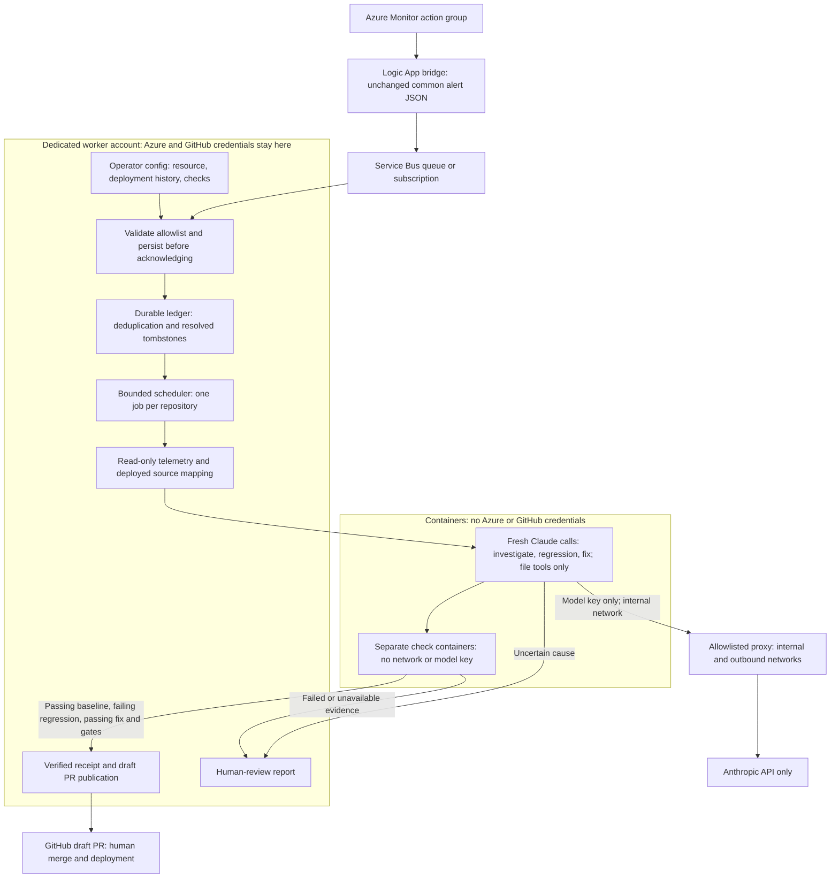

# Local incident worker

`cenci incident run --config /absolute/path/incidents.json` runs an opt-in,
foreground supervisor. Nothing in `cenci daemon` enables or starts it. Use one
state directory for a worker's lifetime, including upgrades and restarts. The
initial coding adapter is Claude Code in Docker or Podman; Service Bus intake,
the durable scheduler, telemetry, and publication are independent interfaces.



Follow the [tutorial](#tutorial-a-worker-identity-on-a-local-host) in order: seven
steps from an empty host to a verified worker identity and a passing staging smoke
test, which must pass before you enable the service. The sections after it are the
reference the steps link to; a worker on an Azure host uses
[Azure-hosted worker identity](#azure-hosted-worker-identity) instead of Steps 2
and 3. Examples use a dedicated Linux account named `incident`, Docker, a Go
repository, and a queue; replace the example resource/repository IDs.

## Tutorial: a worker identity on a local host

This tutorial gives a worker running outside Azure its own least-privilege identity
and proves it end to end. Run every command as the `incident` account unless a step
says otherwise. Each step links to the reference section that holds the detail, so
this text shows the path and not every rule.

Steps 1 to 5 and the smoke test in Step 6 run against the **staging** queue and
workspace. The example names (`contoso`, `monitor-alerts`, `orders-logs`) stand for
the staging resources: never run the tutorial against production, and map production
resources only after the smoke test passes.

Two command shapes keep a failure from closing your terminal or leaving secrets
behind. A block that signs you in is a chain of `&&` commands, so it stops at the first
failure and still leaves your shell open. A block that creates things runs in a
subshell, `( set -euo pipefail ... )`, so any failing command stops the block, and
its `trap` removes temporary key material when the subshell exits. Paste a whole
block at once. Values a subshell computes are printed, because a subshell cannot
hand variables back.

### Step 1: Prerequisites and who is who

Five identities appear below. They stay separate on purpose: none can do another's
job, and the worker never holds a send or administration right.

| Identity | Used for | Rights | Credential |
| --- | --- | --- | --- |
| Bridge | The Logic App delivers alerts to the queue. | Azure Service Bus Data Sender on the queue. | An Azure-side connection, never on the worker host. |
| Worker | `cenci incident run` and `verify`. | Azure Service Bus Data Receiver on the queue; Log Analytics Reader on each mapped workspace. | The config's `auth` section: here a certificate PEM owned by `incident`. |
| Agent containers | Claude calls and the check runs. | None in Azure or GitHub. | The model key only, through the proxy; checks get nothing. |
| Setup operator | You, running `cenci incident setup` and the `az` commands. | Entra rights to create an app registration; an RBAC administrator role on each scope. | Your own `az login`, for setup only. It is never written to the config. |
| Staging sender | Step 6's script that sends test alerts. | Azure Service Bus Data Sender on the staging queue only. | Its own service principal, in a separate terminal. |

The bridge's Data Sender identity is separate from the worker identity: the worker
can receive but never send, and the bridge can send but never receive. The staging
sender is a third identity, so no step lends the worker a send right.

Before Step 2:

1. A human has configured the action group and Logic App bridge ([Provisioning
   and permissions](#provisioning-and-permissions)), and the staging queue and
   workspace exist.
2. The host is prepared: [account and repository](#prepare-the-account-and-repository),
   [job image](#build-and-review-the-job-image) and
   [proxy route](#give-the-proxy-an-outbound-route).
3. You hold the two kinds of rights setup needs, which different people often
   hold: Microsoft Entra rights to create an app registration and its service
   principal, and User Access Administrator or Role Based Access Control
   Administrator on the queue and each workspace. Without the first, an
   administrator creates the identity and you grant roles; without the second,
   you can preview but not assign.
4. The config exists. Save the adapted JSON from [Configuration](#configuration),
   without an `auth` section, as `/home/incident/.config/cenci/incidents.json`
   with mode 0600. Setup needs neither `enabled: true` nor `auth`.

Sign in for setup in a temporary Azure CLI directory, so your login never lands in
the account's own profile. Check that it was created before using it:

```bash
SETUP_AZ_DIR=$(mktemp -d /tmp/cenci-setup-az.XXXXXX) && chmod 0700 "$SETUP_AZ_DIR" && export AZURE_CONFIG_DIR="$SETUP_AZ_DIR" && az login --tenant 11111111-1111-4111-8111-111111111111
```

If that chain stops early, nothing is signed in, but once `export` has run (even
when `az login` itself fails) `AZURE_CONFIG_DIR` stays set to that directory: run the
`SETUP_AZ_DIR` teardown at the end of Step 5. Every later operator sign-in ends with
its own teardown.

### Step 2: Preview what setup will do

The preview changes nothing: it writes no file, calls no mutating `az` command and
never starts the worker. Run it with every input for a new identity:

```bash
cenci incident setup --config /home/incident/.config/cenci/incidents.json \
  --identity new --display-name cenci-incident-worker \
  --tenant 11111111-1111-4111-8111-111111111111 \
  --subscription 44444444-4444-4444-8444-444444444444 \
  --certificate-path /home/incident/.config/cenci/worker.pem \
  --service-bus-namespace-id /subscriptions/44444444-4444-4444-8444-444444444444/resourceGroups/app/providers/Microsoft.ServiceBus/namespaces/contoso \
  --workspace-resource-id 00000000-0000-0000-0000-000000000000=/subscriptions/44444444-4444-4444-8444-444444444444/resourceGroups/app/providers/Microsoft.OperationalInsights/workspaces/orders-logs
```

Sample output, captured from the built binary with no `az` on `PATH` (a guidance-only
preview, exit 0), with only `...` shortening and the config and state paths shown as
the example account's. With `az` signed in, the preview also reads the Azure values it
can and shows them, so yours differs where `az` was missing here:

```text
cenci incident setup: preview only. This run created, changed and wrote nothing; the commands below are for you to review and run yourself.

Config:       /home/incident/.config/cenci/incidents.json
Tenant:       11111111-1111-4111-8111-111111111111
Subscription: 44444444-4444-4444-8444-444444444444
Identity:     new

Values in angle brackets, such as <app-id>, could not be discovered. Replace each one before running the command that contains it.

1. Prerequisites
   Two different kinds of rights are needed, and different people often hold them:
   - Microsoft Entra: rights to create an app registration and its service principal ...
   - Azure RBAC: User Access Administrator or Role Based Access Control Administrator on each scope that receives a role assignment below ...
   The Azure CLI login is used for setup only and is never written to the worker configuration. The worker authenticates only as the identity in its auth section.
   Azure CLI: not found on PATH, so nothing could be discovered. Install it, sign in, and run this preview again to fill in the values below.

2. Worker identity
   Create a dedicated app registration and service principal for the worker. ...
     az ad app create --display-name 'cenci-incident-worker' --query appId -o tsv
     # fill placeholders before running
     az ad sp create --id <app-id>
     # fill placeholders before running
     az ad sp show --id <app-id> --query id -o tsv
   Replace <app-id> with the appId the first command prints, and <object-id> in the role commands with the id the last command prints.

3. Service Bus receive role
   Grant Azure Service Bus Data Receiver on exactly the queue or topic subscription the worker reads, never on the namespace or the topic:
     # fill placeholders before running
     az role assignment create --assignee-object-id <object-id> --assignee-principal-type ServicePrincipal --role 4f6d3b9b-027b-4f4c-9142-0e5a2a2247e0 --scope '/subscriptions/44444444-4444-4444-8444-444444444444/resourceGroups/app/providers/Microsoft.ServiceBus/namespaces/contoso/queues/monitor-alerts'

4. Log Analytics read role
   Grant Log Analytics Reader on each workspace the configured resources query. ...
     # fill placeholders before running
     az role assignment create --assignee-object-id <object-id> --assignee-principal-type ServicePrincipal --role 73c42c96-874c-492b-b04d-ab87d138a893 --scope '/subscriptions/44444444-4444-4444-8444-444444444444/resourceGroups/app/providers/Microsoft.OperationalInsights/workspaces/orders-logs'

5. Certificate credential
   The worker reads one unencrypted PEM file holding its certificate and private key, mode 0600. ...
     umask 077
     # fill placeholders before running
     openssl req -x509 -newkey rsa:2048 -nodes -days 365 -subj '/CN=cenci-incident-worker' -keyout <private-key-file> -out <public-certificate-file>
     # fill placeholders before running
     cat <private-key-file> <public-certificate-file> > '/home/incident/.config/cenci/worker.pem'
   Register only the public certificate on the app registration; --append keeps its other credentials:
     # fill placeholders before running
     az ad app credential reset --id <app-id> --cert @<public-certificate-file> --append

6. Proposed auth section
   Add this to the incident worker config. The worker authenticates only as this identity and never falls back to ambient Azure credentials:
   {
     "mode": "servicePrincipalCertificate",
     "tenantId": "11111111-1111-4111-8111-111111111111",
     "clientId": "<app-id>",
     "certificatePath": "/home/incident/.config/cenci/worker.pem"
   }
   The config has no auth section yet.

7. Local files that apply would touch
   This preview touched none of them. A later apply would create or change:
   - /home/incident/.config/cenci/incidents.json: add the auth section.
   - /home/incident/.config/cenci/worker.pem: apply would create it (certificate and private key, mode 0600).
   - /home/incident/.local/state/cenci/incidents/setup-journal.json: apply would create it to resume after an interruption.
```

Read every command before running anything. The placeholders stay unquoted on
purpose, so an unfilled command fails at the shell instead of running with a wrong
value. Setup rejects bad input with exit 2 and an unusable config with exit 1; see
[Setup preview](#setup-preview) for what it discovers, its flags and its exit codes.

### Step 3: Create the identity, certificate and role assignments

Pick one route. Both end with the same three things: an application with a
service principal and a registered certificate, the two role assignments from the
preview, and an `auth` section in the config.

#### Guided apply (recommended)

Apply carries out the preview's plan after you confirm it. Use the same inputs plus
`--apply` and an explicit `--identity`, as the `incident` account, so the PEM it
generates belongs to the user the worker runs as:

```bash
cenci incident setup --config /home/incident/.config/cenci/incidents.json --apply \
  --identity new --display-name cenci-incident-worker \
  --tenant 11111111-1111-4111-8111-111111111111 \
  --subscription 44444444-4444-4444-8444-444444444444 \
  --certificate-path /home/incident/.config/cenci/worker.pem \
  --service-bus-namespace-id /subscriptions/44444444-4444-4444-8444-444444444444/resourceGroups/app/providers/Microsoft.ServiceBus/namespaces/contoso \
  --workspace-resource-id 00000000-0000-0000-0000-000000000000=/subscriptions/44444444-4444-4444-8444-444444444444/resourceGroups/app/providers/Microsoft.OperationalInsights/workspaces/orders-logs
```

It prints the full plan and then `Apply this plan? [y/N] `; only `y` or `Y`
continues, and anything else exits 1 with nothing created. Without a terminal on
stdin, add `--yes`, which skips the prompt and needs every input as a flag. Apply
creates the missing pieces, writes only the config's `auth` section, and runs
[`verify`](#verifying-the-identity), waiting up to 10 minutes for RBAC to propagate.
Success ends with:

```text
cenci incident setup: apply complete (2 role assignment(s) created).
```

A failed step prints `apply stopped; run the same command again to resume.` with
`completed:`, `failed:` and `remaining:` lines and exits 1. Run the same command
again: the journal in the state directory records progress, so a rerun creates
nothing twice, and a rerun right after a create still waits for propagation. A step
that fails just after the application is created can be Microsoft Graph
replication lag. See [Setup apply](#setup-apply) for the allowlist, journal and
recovery rules.

| Flag | Use |
| --- | --- |
| `--config` | The worker config; required. Apply rewrites only its `auth` section. |
| `--tenant`, `--subscription` | The Entra tenant and the subscription to search; both default from your CLI login, but pass them for an unattended run. |
| `--identity` | `new` here; `existing` reuses an application (see Step 7); `managed` is for [Azure hosts](#managed-identity). Required with `--apply`. |
| `--client-id` | With `existing`, the application to use. With `new`, only with `--apply`, and it adopts only the application this setup's own journal recorded. |
| `--principal-object-id` | `managed` only; see [the hosted identity section](#azure-hosted-worker-identity). |
| `--display-name` | The label of a new application; apply appends a nonce to find it again after an interruption. |
| `--certificate-path` | The absolute PEM path: generated there when absent (never overwritten), used read-only when present. |
| `--service-bus-namespace-id`, `--workspace-resource-id` | Resource IDs `az` could not discover; the second is `<workspace-uuid>=<id>` and repeatable. |
| `--apply`, `--yes` | Carry the plan out; `--yes` confirms without the prompt and is required without a terminal. |
| `--replace-auth` | Replace an existing `auth` section that differs from the plan. |

#### Manual `az` commands

Without apply, an administrator runs the preview's commands. Run them under the
same temporary `AZURE_CONFIG_DIR`, with real IDs and roles by definition ID, exactly
as the preview generates them:

```bash
az account show --query tenantId -o tsv
(
  set -euo pipefail
  umask 077
  PEM=/home/incident/.config/cenci/worker.pem
  # Refuse to overwrite a PEM, and stop before any Azure change if it cannot be installed.
  [ -d "$(dirname "$PEM")" ] && [ ! -e "$PEM" ] || { echo "refusing: the config directory is missing or $PEM already exists" >&2; exit 1; }
  QUEUE_ID=$(az servicebus queue show --resource-group app --namespace-name contoso --name monitor-alerts --query id -o tsv)
  WORKSPACE_ID=$(az monitor log-analytics workspace show --resource-group app --workspace-name orders-logs --query id -o tsv)
  WORK_DIR=$(mktemp -d)
  trap 'shred -u "$WORK_DIR/worker.key" "$WORK_DIR/worker.pem" || true; rm -r -- "$WORK_DIR"' EXIT
  openssl req -x509 -newkey rsa:2048 -sha256 -days 365 -nodes -subj '/CN=cenci-incident-worker' -keyout "$WORK_DIR/worker.key" -out "$WORK_DIR/worker.crt"
  cat "$WORK_DIR/worker.crt" "$WORK_DIR/worker.key" > "$WORK_DIR/worker.pem"
  [ -s "$WORK_DIR/worker.pem" ] || { echo "refusing: the generated PEM is empty" >&2; exit 1; }
  install -m 600 "$WORK_DIR/worker.pem" "$PEM"
  APP_ID=$(az ad app create --display-name cenci-incident-worker --query appId -o tsv)
  az ad sp create --id "$APP_ID"
  az ad app credential reset --id "$APP_ID" --cert @"$WORK_DIR/worker.crt" --append
  PRINCIPAL_ID=$(az ad sp show --id "$APP_ID" --query id -o tsv)
  az role assignment create --assignee-object-id "$PRINCIPAL_ID" --assignee-principal-type ServicePrincipal --role 4f6d3b9b-027b-4f4c-9142-0e5a2a2247e0 --scope "$QUEUE_ID"
  az role assignment create --assignee-object-id "$PRINCIPAL_ID" --assignee-principal-type ServicePrincipal --role 73c42c96-874c-492b-b04d-ab87d138a893 --scope "$WORKSPACE_ID"
  echo "APP_ID=$APP_ID"
  echo "manual identity block complete"
)
```

Any failing command stops the block, and the last two lines print only on success:
copy the `APP_ID` for Step 4. The PEM is installed before the first Azure change, so
once anything exists in Azure the key also exists at its destination, and the `trap`
removes the temporary copy however the block ends (shredding is best effort). The
block refuses to run when `worker.pem` already exists, so it never overwrites a key;
move the old one aside deliberately first.

**If the block stops**, the manual route has no setup journal, so [Undo a setup
apply](#undo-a-setup-apply) does not apply to it. If it stopped before the
application was created, remove the unregistered PEM and rerun. If it stopped after,
find the application with `az ad app list --display-name cenci-incident-worker`,
delete it with `az ad app delete --id <app-id>` and its role assignments
(`az role assignment list` then `az role assignment delete --ids`), and then remove
the PEM; otherwise a rerun creates a second application. The renewal and hosted
blocks recover the same way. Only the public certificate goes to `az`; `--append`
keeps the application's other credentials. Managed identity and workload identity
federation are in [the hosted identity section](#azure-hosted-worker-identity).

### Step 4: Configure the service account and environment

Apply wrote the `auth` section already; on the manual route add it yourself, with
the `APP_ID` from Step 3 as `clientId`. The config then holds only non-secret
values: the certificate's path, never its contents.

```json
{
  "auth": {
    "mode": "servicePrincipalCertificate",
    "tenantId": "11111111-1111-4111-8111-111111111111",
    "clientId": "22222222-2222-4222-8222-222222222222",
    "certificatePath": "/home/incident/.config/cenci/worker.pem"
  }
}
```

Create the environment file with mode 0600 **before** entering any secret. It holds
only the model key; obtain the value from the credential owner rather than putting
it in shell history. The Azure identity lives in the config's `auth` section and
the PEM it names, never in this file, and `AZURE_*` entries here would be ignored
and removed.

```bash
if [ -e /home/incident/.config/cenci/incidents.env ]; then echo "incidents.env exists: edit it, do not recreate it" >&2; else install -m 600 /dev/null /home/incident/.config/cenci/incidents.env; fi
```

An existing file keeps its contents and its mode: never truncate it.

```text
ANTHROPIC_API_KEY=your-model-key
```

Check that the worker's account owns all three files and that the modes are
restrictive. The worker refuses a certificate that is not an owned regular file
with mode `0600` or `0400`:

```bash
stat -c '%U:%G %a %n' /home/incident/.config/cenci/worker.pem /home/incident/.config/cenci/incidents.json /home/incident/.config/cenci/incidents.env
```

Expect `incident:incident 600` for each. The user service that loads
`incidents.env` is in [Lifecycle and recovery](#lifecycle-and-recovery); enable it
only after Step 6. For a foreground run, load the key through your approved secret
manager into the worker's environment, then run `cenci incident run --config
/home/incident/.config/cenci/incidents.json`. Do not place GitHub or Azure secrets
in the image or the JSON configuration.

### Step 5: Verify the identity and its limits

Check the identity and its role assignments before starting the worker. Right
after granting roles, wait for propagation:

```bash
cenci incident verify --config /home/incident/.config/cenci/incidents.json --propagation-wait 5m
```

Expect exit 0 and one line per probe (sanitized):

```text
identity: tenant 11111111-1111-4111-8111-111111111111, application 22222222-2222-4222-8222-222222222222, principal 33333333-3333-4333-8333-333333333333
workspace 00000000-0000-0000-0000-000000000000 (/subscriptions/.../sites/orders): ok (1 rows)
broker monitor-alerts: ok (0 messages visible)
note: an empty peek proves receive authorization only; it does not show that alerts reach this entity
```

Each check proves something narrow:

| Check | Proves | Does not prove |
| --- | --- | --- |
| Identity | The credential loads, tokens arrive for both scopes, and the claims match the configured tenant, application and principal. | That any role exists; claims are read without checking the signature. |
| Workspace | The role lets the identity run the resource's configured query over the last 5 minutes. | That the query finds an incident's evidence. Result rows are never printed. |
| Broker | The role lets the identity peek one message from the queue or subscription. | That alerts reach the entity (the bridge), that sending works, or that a lock, settle or renew works. |

A failed probe prints one of six classes; [Verifying the identity](#verifying-the-identity)
explains each, and Step 7's table says what to do. `verify` takes no worker lock and
changes nothing, so it can run beside a live worker.

Once verify passes, drop the setup login. The setup directory holds your tokens.
This is the teardown every operator sign-in ends with: it signs out of that
directory only, removes it when it exists, and clears the variables:

```bash
if [ -n "${SETUP_AZ_DIR:-}" ] && [ -d "$SETUP_AZ_DIR" ]; then AZURE_CONFIG_DIR="$SETUP_AZ_DIR" az logout; rm -r -- "$SETUP_AZ_DIR" && unset AZURE_CONFIG_DIR SETUP_AZ_DIR; else echo "nothing to tear down: SETUP_AZ_DIR is unset (run this in the terminal that signed in)" >&2; fi
```

### Step 6: Run the staging smoke test

Use a staging-only queue, resource, workspace, and GitHub repository with a known
small application defect, a passing existing test suite, committed guidance and
a deployed runbook describing the symptom. Set deployment history to include the
payload's fired time. Use `concurrency: 1`, `maxAttempts: 1` and an affordable
`budgetUsd` for the first run. Model outcomes are nondeterministic: a `review`
result is safe, but does not prove the draft-PR path works. Resolve setup failures
and repeat with a **new** alert identity until the complete path is exercised.
This live run, not the mocked suites, is the evidence for real Azure permissions,
broker intake and telemetry.

First check offline dependencies under the same read-only image, host UID and
writable `/tmp` constraints. For the Go example:

```bash
(
  set -euo pipefail
  PREFLIGHT=/home/incident/incident-setup/preflight
  # A leftover path would make the test below run a stale tree: refuse it.
  [ ! -e "$PREFLIGHT" ] || { echo "refusing: $PREFLIGHT already exists" >&2; exit 1; }
  git -C /home/incident/repos/orders worktree add --detach "$PREFLIGHT" origin/main
  trap 'git -C /home/incident/repos/orders worktree remove --force "$PREFLIGHT"' EXIT
  INCIDENT_UID=$(id -u)
  INCIDENT_GID=$(id -g)
  docker run --rm --network none --read-only --cap-drop=ALL --security-opt=no-new-privileges --pids-limit=128 --memory=2g --cpus=2 --user "$INCIDENT_UID:$INCIDENT_GID" --tmpfs /tmp:rw,nosuid,size=512m,mode=1777 --env HOME=/tmp --volume "$PREFLIGHT":/workspace:rw --workdir /workspace --entrypoint go incident-tools:reviewed test -buildvcs=false ./...
  echo "preflight complete"
)
```

Expect `preflight complete` and exit 0 without package downloads or permission
failures. The block stops if `preflight` already exists, and removes the worktree
when it ends. The preflight
disables VCS stamping because it has no mounted Git metadata; real jobs supply
isolated metadata and run the exact configured gates. Adapt the command for your
stack, and ensure every gate works offline during the full smoke run.

Run [`cenci incident verify`](#verifying-the-identity) with the staging config
as in Step 5. An empty queue proves receive authorization only, so the smoke test
below is what shows that alerts arrive. Resolve any failure class before starting
the worker.

#### Create the staging sender identity

The worker's Receiver role cannot send, and the worker must not gain a send right.
Alerts come from a separate staging sender: its own service principal with Azure
Service Bus Data Sender (`69a216fc-b8fb-44d8-bc22-1f3c2cd27a39`) at the staging
queue scope only; never grant it on a production queue or the namespace. Creating
it is setup-operator work, not the worker's: an operator may run it from their own
account instead of `incident`, with `SENDER_DIR` set to a 0700 directory that
account owns, and then hand `sender.pem` to the sender terminal's account with mode
0600. Sign in first, in a terminal with its own temporary `AZURE_CONFIG_DIR`, then
create the identity (replace the resource names with the **staging** values):

```bash
OPERATOR_AZ_DIR=$(mktemp -d /tmp/cenci-operator-az.XXXXXX) && chmod 0700 "$OPERATOR_AZ_DIR" && export AZURE_CONFIG_DIR="$OPERATOR_AZ_DIR" && az login --tenant 11111111-1111-4111-8111-111111111111
```

```bash
(
  set -euo pipefail
  umask 077
  SENDER_DIR=/home/incident/incident-setup/sender
  install -d -m 700 "$SENDER_DIR"
  [ ! -e "$SENDER_DIR/sender.pem" ] || { echo "refusing: $SENDER_DIR/sender.pem already exists" >&2; exit 1; }
  STAGING_QUEUE_ID=$(az servicebus queue show --resource-group app --namespace-name contoso --name monitor-alerts --query id -o tsv)
  openssl req -x509 -newkey rsa:2048 -sha256 -days 30 -nodes -subj '/CN=cenci-staging-sender' -keyout "$SENDER_DIR/sender.key" -out "$SENDER_DIR/sender.crt"
  cat "$SENDER_DIR/sender.crt" "$SENDER_DIR/sender.key" > "$SENDER_DIR/sender.pem"
  [ -s "$SENDER_DIR/sender.pem" ] || { echo "refusing: the generated sender PEM is empty" >&2; exit 1; }
  SENDER_APP_ID=$(az ad app create --display-name cenci-staging-sender --query appId -o tsv)
  az ad sp create --id "$SENDER_APP_ID"
  az ad app credential reset --id "$SENDER_APP_ID" --cert @"$SENDER_DIR/sender.crt" --append
  SENDER_PRINCIPAL_ID=$(az ad sp show --id "$SENDER_APP_ID" --query id -o tsv)
  az role assignment create --assignee-object-id "$SENDER_PRINCIPAL_ID" --assignee-principal-type ServicePrincipal --role 69a216fc-b8fb-44d8-bc22-1f3c2cd27a39 --scope "$STAGING_QUEUE_ID"
  echo "SENDER_APP_ID=$SENDER_APP_ID SENDER_PRINCIPAL_ID=$SENDER_PRINCIPAL_ID"
  echo "sender creation complete"
)
```

Any failing command stops the block, and the last two lines print only on success:
copy `SENDER_APP_ID` and `SENDER_PRINCIPAL_ID` for the sender sign-in and the cleanup
below. The key files stay in `SENDER_DIR` for the test and are removed in the
cleanup. If the block stops, recover as in Step 3: delete a created application and
its assignment, and remove the key files. Then end the operator sign-in:

```bash
if [ -n "${OPERATOR_AZ_DIR:-}" ] && [ -d "$OPERATOR_AZ_DIR" ]; then AZURE_CONFIG_DIR="$OPERATOR_AZ_DIR" az logout; rm -r -- "$OPERATOR_AZ_DIR" && unset AZURE_CONFIG_DIR OPERATOR_AZ_DIR; else echo "nothing to tear down: OPERATOR_AZ_DIR is unset (run this in the terminal that signed in)" >&2; fi
```

#### Send alerts from a separate terminal

Start the worker in a foreground terminal with its credentials loaded. In a
**separate sender terminal**, sign in as the staging sender with its own
`AZURE_CONFIG_DIR`, so neither login can leak into the other:

```bash
SENDER_AZ_DIR=$(mktemp -d /tmp/cenci-sender-az.XXXXXX) && chmod 0700 "$SENDER_AZ_DIR" && export AZURE_CONFIG_DIR="$SENDER_AZ_DIR" && az login --service-principal --username <sender-app-id> --certificate /home/incident/incident-setup/sender/sender.pem --tenant 11111111-1111-4111-8111-111111111111
```

Install Python `azure-identity` and `azure-servicebus` in a dedicated virtual
environment, as in the [Azure Python queue quickstart](https://learn.microsoft.com/en-us/azure/service-bus-messaging/service-bus-python-how-to-use-queues).
For example, create `/home/incident/incident-setup/sender-venv` with
`python3 -m venv`, activate it, then run `python -m pip install azure-identity
azure-servicebus` in that sender terminal.
Save this small sender as `/home/incident/incident-setup/send-alert.py`:

```python
# Sender-only: this credential chain belongs to the staging sender, never the worker.
import json
import sys
import uuid
from pathlib import Path
from azure.identity import DefaultAzureCredential
from azure.servicebus import ServiceBusClient, ServiceBusMessage

payload = json.loads(Path(sys.argv[1]).read_text())
with DefaultAzureCredential() as credential:
    with ServiceBusClient("contoso.servicebus.windows.net", credential) as client:
        with client.get_queue_sender("monitor-alerts") as sender:
            sender.send_messages(ServiceBusMessage(
                json.dumps(payload), content_type="application/json",
                message_id=str(uuid.uuid4())))
```

The sender's `DefaultAzureCredential` finds the staging sender's CLI login in the
sender terminal. It is the sender's identity, not the worker's: the worker never
uses it or any credential chain. Replace the namespace and queue in the sender
with the **staging** values.
Save `/home/incident/incident-setup/fired.json` using the mapped staging resource,
a unique alert identity for this smoke run, and a fired time covered by the
deployment interval and staging telemetry:

```json
{
  "schemaId": "azureMonitorCommonAlertSchema",
  "data": {
    "essentials": {
      "alertId": "cenci-staging-smoke-2026-10-10-001",
      "monitorCondition": "Fired",
      "alertTargetIDs": ["/subscriptions/00000000-0000-0000-0000-000000000000/resourceGroups/app/providers/Microsoft.Web/sites/orders"],
      "firedDateTime": "2026-10-10T09:00:00Z",
      "description": "Staging fixture: describe the known application defect and observable symptom."
    }
  }
}
```

```bash
python /home/incident/incident-setup/send-alert.py /home/incident/incident-setup/fired.json
cenci incident status --state-dir /home/incident/.local/state/cenci/incidents
```

#### Acceptance checks

Use repeated `status` calls and the following acceptance checks. Retain the
incident key, reports, and PR URL as the staging record; do not delete the ledger
between steps.

| Step | Action | Expected result |
| --- | --- | --- |
| Intake | Send the fired payload above. | One ledger row, the mapped deployed SHA, then `queued`/`running` (these may be brief); Service Bus active message count falls after durable intake. |
| Coding and publication | Wait for completion; inspect `artifacts/<key>/investigation-input.json`, `investigation-result.json`, and `publication.json`, plus the draft PR. | Authenticated Claude calls succeed through the proxy; baseline passes, added regression fails before the fix and passes after it; every configured gate passes offline; `draft` has one PR URL with evidence and verification. A `review` report explains any stopped stage. |
| Duplicate delivery | Run the same sender command again; it creates a new broker message ID with the same `alertId`. | Same ledger key, attempts/reserved cost and PR; no second coding job or PR. |
| Restart | Stop the foreground worker with Ctrl-C, restart with the same config/state, then resend `fired.json`. | Completed incident stays terminal with the same PR and cost; no duplicate job. For interrupted-job recovery, use a separate identity and stop during a running job: partial edits may correctly produce `review`. |
| Resolution | Copy the payload to `resolved.json`, change only `monitorCondition` to `Resolved`, then send it with the same script. | Row becomes `resolved`; queued/active execution stops, existing PR stays available. Sending the original fired payload again cannot restart it. |
| Out-of-order resolution | Use a new `alertId`; send its resolved payload before its fired payload. | One `resolved` tombstone with zero attempts and no PR. |
| Bridge delivery | Trigger and resolve the real staging Azure Monitor alert through the configured action group/Logic App. | The bridge preserves the schema/resource/identity; the same intake and resolution behavior occurs. Direct queue sends alone do not verify the bridge. |

If intake never appears, inspect the bridge run, Service Bus DLQ, resource
allowlist, and the worker's Azure permissions. If a row retries or ends in
`review`, inspect its `report` first, then image tools/caches, proxy logs, Git
authentication/author, deployment SHA and runbook availability. Confirm real
telemetry was returned rather than accepting an empty-query result as proof of
the fixture. Only after these checks should you enable the user service and map
production resources. This procedure is an operator acceptance test; the local
test suite below does not execute it or provision its infrastructure.

#### Clean up the staging sender

When the test is done, remove the staging sender and everything it left behind. In
the sender terminal, sign out, then remove the key material, the virtual
environment and the sign-in directory. `shred` is best effort, so the last command
must print nothing, which shows no key file remains. If an operator created the
sender from their own account, they remove their own `sender.key` and `sender.pem`
copies in that directory too:

```bash
if [ -n "${SENDER_AZ_DIR:-}" ] && [ -d "$SENDER_AZ_DIR" ]; then AZURE_CONFIG_DIR="$SENDER_AZ_DIR" az logout; rm -r -- "$SENDER_AZ_DIR" && unset AZURE_CONFIG_DIR SENDER_AZ_DIR; else echo "nothing to tear down: SENDER_AZ_DIR is unset (run this in the terminal that signed in)" >&2; fi
SENDER_DIR=/home/incident/incident-setup/sender
shred -u -- "$SENDER_DIR/sender.key" "$SENDER_DIR/sender.pem" 2>/dev/null; rm -r -- "$SENDER_DIR" /home/incident/incident-setup/sender-venv
find "$SENDER_DIR" -name 'sender.*' 2>/dev/null
```

As the setup operator, sign in as above (the `OPERATOR_AZ_DIR` chain), remove the
sender's Data Sender assignment and then its application, and end with the
`OPERATOR_AZ_DIR` teardown. The role filter keeps the worker's Receiver assignment
on the same queue safe, and deleting the application alone would leave an orphaned
assignment:

```bash
(
  set -euo pipefail
  SENDER_PRINCIPAL_ID=<sender-principal-id>
  SENDER_APP_ID=<sender-app-id>
  STAGING_QUEUE_ID=$(az servicebus queue show --resource-group app --namespace-name contoso --name monitor-alerts --query id -o tsv)
  ASSIGNMENT_IDS=$(az role assignment list --assignee-object-id "$SENDER_PRINCIPAL_ID" --scope "$STAGING_QUEUE_ID" --role 69a216fc-b8fb-44d8-bc22-1f3c2cd27a39 --query '[].id' -o tsv)
  [ -n "$ASSIGNMENT_IDS" ] || { echo "refusing: no Data Sender assignment found for the sender" >&2; exit 1; }
  echo "$ASSIGNMENT_IDS"
  read -r -p "Delete exactly the assignment IDs listed above, then the application? [y/N] " answer
  [ "$answer" = y ] || { echo "refusing: not confirmed" >&2; exit 1; }
  az role assignment delete --ids $ASSIGNMENT_IDS
  az ad app delete --id "$SENDER_APP_ID"
  echo "sender removal complete"
)
```

The sender's `send-alert.py` and `fired.json` hold no secret and can stay.

### Step 7: Migrate, troubleshoot, renew, revoke and undo

#### Migrate an existing install

Earlier versions authenticated through an ambient Azure credential chain, typically
a client secret in `incidents.env` (`AZURE_TENANT_ID`, `AZURE_CLIENT_ID`,
`AZURE_CLIENT_SECRET`), a managed identity, or a developer's CLI session. Those
configs have no `auth` section and now stop starting with the message under
[Worker identity](#worker-identity). There is no client-secret mode, so a
secret-based install moves to a certificate:

1. Register a certificate for the existing application. Migration skips Step 3's
   application, service principal and role-assignment commands, because the
   application and its roles already exist. Instead run the snippet under
   [Renew a certificate](#renew-a-certificate), signed in as the setup operator as in
   Step 1, filling its two assignments after `set`: `APP_ID` is the application's
   `clientId` and `NEW_PEM` is `/home/incident/.config/cenci/worker.pem`, since no PEM
   exists yet. Then run the `SETUP_AZ_DIR` teardown at the end of Step 5.
2. Add the `auth` section to the config, with the existing application's
   `clientId` and the tenant's `tenantId`. Alternatively run `cenci incident
   setup --apply --identity existing --client-id <app-id>` with
   `--certificate-path` pointing at that PEM: it adds any missing role
   assignments, writes `auth` and verifies, and needs `--replace-auth` if an
   `auth` section already differs.
3. Remove the `AZURE_*` lines from `incidents.env`; they would be ignored and
   removed anyway.
4. Start the worker and run `cenci incident verify`; it must exit 0 with `ok` lines
   for the identity, workspace and broker. Only then delete the old client secret
   from the app registration; if verify fails, keep the secret.

Installs on a managed identity only need `auth` with `mode` `managedIdentity`
and, for a user-assigned identity, its `clientId`. Add the identity's
`principalObjectId` to pin it. An `auth` section written by an earlier
`cenci incident setup --apply` has no pin; rerun apply with `--replace-auth` to add it.

#### Troubleshoot

| Symptom | Likely cause | What to do |
| --- | --- | --- |
| `run` exits 1: `no explicit worker identity is configured` | The config has no `auth` section. | Finish Step 3 and 4, or follow the migration above. |
| `certificate <path> has mode 0644` | The PEM is not mode `0600` or `0400`, or not owned by the worker. | Fix the mode and owner as in Step 4. |
| `certificate expired`, or the 30-day expiry warning | The certificate is at or near its `NotAfter`. | Renew it (below). |
| `worker identity preflight: ...` (five classes) | A token request failed, or its tenant, application or principal claim differs from `auth`. | [Startup checks](#startup-checks) names each class. |
| `verify`: `authorization-denied` | The role assignment is missing, wrong or not yet effective. | Check the scope and role; after a grant, rerun with `--propagation-wait 5m`. |
| `verify`: `rbac-propagation-timeout` | The denial outlasted the whole wait. | Confirm the assignment, then rerun with a longer wait, up to 15 minutes. |
| `verify`: `identity-mismatch` | The token's tenant, application or principal differs from `auth`. | Correct `tenantId`, `clientId` or `principalObjectId`, or the identity that holds the certificate. |
| `verify`: `authentication-failed`, `resource-not-found`, `unreachable` | No token, a missing workspace or queue, or no route to the service. | Check the credential and names; [Verifying the identity](#verifying-the-identity) explains each. |
| `setup` exits 1 or 2 | A runtime failure or a usage error, before or after any change. | Read the message, which names the flag; [Setup apply](#setup-apply) lists the exit codes. A failed apply resumes by rerunning it. |
| An incident is stuck or unwanted | A queued or running job you no longer want. | Cancel it, as below; reports, branches and PRs are kept. |

```bash
cenci incident cancel --state-dir /home/incident/.local/state/cenci/incidents --id INCIDENT_KEY
```

#### Renew a certificate

Renewal is a manual procedure, and setup has no rotation flag. Start well before
the 30-day warning:

1. Sign in as the setup operator as in Step 1, then create the new certificate at a
   new path and append its public certificate to the application, which keeps the
   old one. The snippet does not touch the application's identity, the role
   assignments or the live PEM, and uses the same safety rules as Step 3: any
   failing command stops it, it refuses to overwrite an existing PEM, checks the
   PEM is non-empty before installing, and its `trap` removes the temporary key
   however it ends. Fill the two assignments after `set`: an unfilled `<placeholder>`
   stops the block before anything is written. If it stops, recover as after Step 3's
   block. It prints `certificate append complete` on success:

```bash
(
  set -euo pipefail
  APP_ID=<app-id>
  NEW_PEM=<new-pem-path>
  umask 077
  [ -d "$(dirname "$NEW_PEM")" ] && [ ! -e "$NEW_PEM" ] || { echo "refusing: the directory is missing or $NEW_PEM already exists" >&2; exit 1; }
  WORK_DIR=$(mktemp -d)
  trap 'shred -u "$WORK_DIR/new.key" "$WORK_DIR/new.pem" || true; rm -r -- "$WORK_DIR"' EXIT
  openssl req -x509 -newkey rsa:2048 -sha256 -days 365 -nodes -subj '/CN=cenci-incident-worker' -keyout "$WORK_DIR/new.key" -out "$WORK_DIR/new.crt"
  cat "$WORK_DIR/new.crt" "$WORK_DIR/new.key" > "$WORK_DIR/new.pem"
  [ -s "$WORK_DIR/new.pem" ] || { echo "refusing: the generated PEM is empty" >&2; exit 1; }
  install -m 600 "$WORK_DIR/new.pem" "$NEW_PEM"
  az ad app credential reset --id "$APP_ID" --cert @"$WORK_DIR/new.crt" --append
  echo "certificate append complete"
)
```

2. Run the `SETUP_AZ_DIR` teardown at the end of Step 5. Set `certificatePath` in the
   config to the new file, restart the worker and run `cenci incident verify`.
3. After review, remove the old credential by its key ID. Sign in again, then list the
   credentials and check which `keyId` belongs to the old certificate:

```bash
az ad app credential list --id <app-id>
```

   Only then delete that one key:

```bash
az ad app credential delete --id <app-id> --key-id <old-key-id>
```

Then run the `SETUP_AZ_DIR` teardown again and securely remove the old PEM file
with `shred -u <old-pem-path>`.

#### Revoke the worker's access

Stop the worker first (SIGTERM, or `systemctl --user stop cenci-incident`), then cut
the access: delete its credential with `az ad app credential delete --id <app-id>
--key-id <key-id>`, and remove the two role assignments (see the undo below). Do not
expect the cut to be instant. Role-assignment removal takes minutes to propagate, and
an established Service Bus link stays authorized until its token expires, as do
tokens that were already issued. Removing the role assignments is what ends access to
the queue and workspace; deleting the credential only stops new tokens. For a
managed identity, remove the identity from the VM as well (`az vm identity remove`),
since it has no credential to delete.

Confirm the cut in two parts. `cenci incident verify --config
/home/incident/.config/cenci/incidents.json` proves only that the credential is
dead: once it is deleted and its tokens have expired, verify reports
`authentication-failed` and runs no resource probe. Prove the role removal with `az
role assignment list --assignee-object-id <principalId> --all --subscription
<subscription-id> -o json` (it covers one subscription only), which must return `[]`;
anything else may still be live, so recheck. Cancel queued incidents you do not want.

#### Undo a setup apply

Setup never deletes anything and there is no cleanup command. Undo is a manual
procedure derived from the setup journal, and every step starts with a review:
nothing below is safe to run on trust. Stop the worker, sign in as the setup
operator as in Step 1, and read the journal:

```bash
jq '{identity, displayName, clientId, principalId, steps: [.steps[] | {name, status}]}' /home/incident/.local/state/cenci/incidents/setup-journal.json
```

It names the identity mode, the application's `clientId`, the principal's
`principalId` and one `role assignment: <role> at <scope>` step per assignment.
Treat the statuses with care. Each run rewrites them, and `unchanged` means the
assignment already existed at the latest run, so it may predate setup and belong
to something else. The journal alone cannot show who created an assignment.

For each such step, review the exact assignment: read it with the principal, scope
and role from the step, and confirm it is the one you mean to remove.

```bash
az role assignment list --assignee-object-id <principalId> --scope <scope> --role <role> -o json
```

Only after that review, delete it by its exact ID, one assignment per command:

```bash
az role assignment delete --ids <assignment-id>
```

Then read the same assignment again; the answer must be an empty list, `[]`:

```bash
az role assignment list --assignee-object-id <principalId> --scope <scope> --role <role> -o json
```

Delete the identity only when the journal's `identity` is `new`. An `existing` or
`managed` identity was not created by setup, so leave it. First read the
application's display name:

```bash
az ad app show --id <clientId> --query displayName -o tsv
```

Compare the printed name with the journal's `displayName`. Only when they are equal
and you have reviewed the application, run the second command:

```bash
az ad app delete --id <clientId>
```

Deleting an application also removes its service principal and credentials, and it
is a soft delete that Entra keeps for 30 days. These commands are the whole undo:
no command deletes the incident ledger or unrelated Azure resources, and the
certificate PEM, the config and the state directory stay for you to remove by hand.
Run the `SETUP_AZ_DIR` teardown at the end of Step 5.

## Provisioning and permissions

Have a human configure an Azure Monitor action group/Logic App bridge to send the
[common alert schema](https://learn.microsoft.com/en-us/azure/azure-monitor/alerts/alerts-common-schema)
unchanged to a Service Bus queue or topic subscription. Enable resolved
notifications. The first release accepts exactly one allowlisted alert target
per message; ambiguous multi-resource messages go to the broker dead-letter
queue rather than guessing a repository. Use normal peek-lock delivery, not
sessions or receive-and-delete. Keep the broker backlog long enough to cover
offline periods. Configure broker `MaxDeliveryCount` and monitor its DLQ.

Run the worker under a dedicated local account. Give its Azure identity Service
Bus Data Receiver on this queue/subscription and read-only Log Analytics query
access on the mapped workspaces. The worker authenticates only as the identity
named in the `auth` section of its config (see [Worker identity](#worker-identity)):
a service principal certificate, a managed identity, or a workload identity. It
never falls back to ambient environment variables, a local Azure CLI login, or
any other credential chain, so use a dedicated least-privilege identity rather
than a production contributor's login. The telemetry client sends only the trusted configured KQL query to
the Log Analytics query endpoint, with a 30-minute window around the alert.
Alert descriptions, URLs, queries, and logs never select credentials, commands,
resources, repositories, deployment commits, or network destinations.

The bridge identity needs **Azure Service Bus Data Sender** on the queue; the
worker needs **Azure Service Bus Data Receiver** on that queue and **Log Analytics
Reader** on each configured workspace (or narrower table query permissions).
An Azure administrator assigns these roles (the commands are in
[tutorial Step 3](#step-3-create-the-identity-certificate-and-role-assignments));
the worker does not create resources or role assignments. See the [Service Bus role scopes](https://learn.microsoft.com/en-us/azure/service-bus-messaging/service-bus-managed-service-identity)
and [workspace query permissions](https://learn.microsoft.com/en-us/azure/azure-monitor/logs/manage-access).
Configure the Logic App's Service Bus send action to use the incoming request
body as the message body, without stringifying/wrapping it in another JSON object.
Use an alert rule that sends both `Fired` and `Resolved` notifications.

The worker account also needs local Git checkouts, Git branch push access, and
`gh` authentication for draft PR writes. Require human approval in repository
branch protection and deployment environments; do not grant this account merge,
deployment, infrastructure, or production write permission. There is no worker
operation to merge, enable automerge, deploy, or mutate production resources.

Prepare an image containing a current Claude Code CLI (at least v2.1.248), Git,
the project stack, and all dependencies needed for offline checks. Supply
`ANTHROPIC_API_KEY` to the worker; the runtime forwards only that named secret
to agent containers. The image must not embed production or GitHub credentials.
No user home, Azure/GitHub credential files, runtime socket, or main checkout is
mounted into jobs. Agents see the incident worktree and a read-only bare history
clone and deployed source snapshot. A read-only `.git` pointer to that isolated
metadata view replaces the host linked-worktree pointer inside containers, so Git
status/VCS build probes work without exposing host repository credentials.
Claude runs in restricted mode with file tools only; commands execute
through the separate check runner without the model key. Repository-defined
hooks, MCP servers, shell tools, and persisted agent sessions are disabled.

Create a **dedicated internal** Docker/Podman network and a proxy on it that
allows only the model API (for example `api.anthropic.com:443`), denies metadata
endpoints, private/production destinations, and arbitrary CONNECT requests, and
enforces any required provider billing limit. Do not attach production services
to this network. The worker refuses a network whose `Internal` flag is false.
It never provisions or alters this network or proxy. Agent containers use the
proxy; check containers use `--network none` and receive no model key. Container
roots are read-only, capabilities are dropped, privilege escalation is disabled,
and CPU, memory, and process counts are bounded. Local container administration
and the operator's image/proxy are trusted boundaries.

### Prepare the account and repository

Install `cenci`, Docker Engine, Git, and `gh` on the worker host. The account must
be able to run Docker and reach Microsoft Entra ID (`login.microsoftonline.com`; managed identity uses
its host's local endpoint instead), Service Bus, Log Analytics, and GitHub endpoints from the host. Authenticate Git and `gh` as the dedicated bot
using your organization's approved credential method. These credentials remain
on the host. For HTTPS clones, `gh auth setup-git` configures Git to use the
existing `gh` login; `gh auth status` verifies it without printing the token.

Run as the `incident` account:

```bash
install -d -m 700 /home/incident/.config/cenci /home/incident/.local/state/cenci/incidents
install -d -m 700 /home/incident/repos /home/incident/incident-setup
git clone https://github.com/contoso/orders.git /home/incident/repos/orders
git -C /home/incident/repos/orders config user.name 'Contoso incident bot'
git -C /home/incident/repos/orders config user.email 'incident-bot@contoso.example'
git -C /home/incident/repos/orders remote get-url origin
realpath /home/incident/repos/orders
git -C /home/incident/repos/orders show origin/main:AGENTS.md
git -C /home/incident/repos/orders show origin/main:.cenci/config.json
git -C /home/incident/repos/orders show 0123456789abcdef0123456789abcdef01234567:docs/runbooks/orders.md
```

The last three commands must succeed. Commit root `AGENTS.md` and a valid cenci
`.cenci/config.json` to the configured base branch before starting: untracked
local files are absent from incident worktrees. Each runbook must exist at the
**deployed commit**, which must be present in this clone. Guidance/config come
from the current base; deployed source/runbooks come from deployment history.
Use the `realpath` output for `resources[].dir`. `origin` must match `repo`
exactly as `https://github.com/OWNER/REPO[.git]` or
`git@github.com:OWNER/REPO.git`; credential-bearing URLs and custom aliases fail
the origin check. Populate deployment timestamps from your release records,
including old releases needed for delayed alerts.

### Build and review the job image

Save this example as `/home/incident/incident-setup/Dockerfile.jobs`. Adapt the
Go version to the repository and add every tool its configured gates need.
Build inputs must be reviewed; pin base image digests in your operator-managed
copy before production use. This example uses the supported Claude CLI minimum;
review newer versions before changing the pin.

```dockerfile
FROM node:22-bookworm-slim AS node
FROM golang:1.25-bookworm
COPY --from=node /usr/local/ /usr/local/
RUN apt-get update && apt-get install -y --no-install-recommends git curl ca-certificates \
    && rm -rf /var/lib/apt/lists/* \
    && npm install -g @anthropic-ai/claude-code@2.1.248
ENV GOMODCACHE=/opt/go-mod GOPATH=/tmp/go GOCACHE=/tmp/go-build \
    GOTOOLCHAIN=local GOFLAGS=-mod=readonly
WORKDIR /opt/dependencies
COPY go.mod go.sum ./
RUN go mod download && chmod -R a+rX /opt/go-mod
WORKDIR /tmp
```

```bash
docker build -f /home/incident/incident-setup/Dockerfile.jobs -t incident-tools:reviewed /home/incident/repos/orders
docker run --rm --entrypoint claude incident-tools:reviewed --version
```

For multi-module repos, preload every module's dependencies; for other stacks,
replace Go with their toolchains, offline packages and writable cache locations.
The worker overrides the entrypoint, sets the host UID/GID and `HOME=/tmp`, and
mounts the image root read-only with only `/tmp` and the worktree writable. Tools
installed solely in `/root`, dependencies needing downloads, and caches under a
read-only image path will fail. The image must have no embedded credentials.

### Give the proxy an outbound route

An [internal Docker network](https://docs.docker.com/reference/cli/docker/network/create/#network-internal-mode---internal)
has no external route. Attach **only the proxy** to both the internal job network
and a separate outbound network; agents get only the internal network. Do not
publish proxy ports to the host. Internal networks can still reach host gateway
services, so keep those interfaces free of sensitive listeners or block them with
the host firewall; do not treat `--internal` as isolation from the Docker host.

Save `/home/incident/incident-setup/Dockerfile.proxy`:

```dockerfile
FROM debian:bookworm-slim
RUN apt-get update && apt-get install -y --no-install-recommends squid ca-certificates \
    && rm -rf /var/lib/apt/lists/*
ENTRYPOINT ["squid", "-N", "-f", "/etc/squid/squid.conf"]
```

Save `/home/incident/incident-setup/squid.conf`. These
[Squid ACLs](https://www.squid-cache.org/Doc/config/acl/) allow only CONNECT to the
exact model hostname on port 443, after rejecting private/reserved destinations.
The proxy does not decrypt TLS and does not need the model key.

```text
http_port 3128
acl CONNECT method CONNECT
acl tls_port port 443
acl model_api dstdomain -n api.anthropic.com
acl forbidden dst 0.0.0.0/8 10.0.0.0/8 100.64.0.0/10 127.0.0.0/8 169.254.0.0/16 172.16.0.0/12 192.168.0.0/16 224.0.0.0/4 240.0.0.0/4
acl forbidden dst ::/128 ::1/128 fc00::/7 fe80::/10 ff00::/8
http_access deny forbidden
http_access allow CONNECT tls_port model_api
http_access deny all
cache deny all
access_log stdio:/tmp/access.log
cache_log /tmp/cache.log
pid_filename /tmp/squid.pid
```

```bash
docker build -f /home/incident/incident-setup/Dockerfile.proxy -t incident-proxy:reviewed /home/incident/incident-setup
docker network create --internal cenci-incident-model
docker network create cenci-incident-egress
docker create --name model-proxy --restart unless-stopped --network cenci-incident-egress --mount type=bind,src=/home/incident/incident-setup/squid.conf,dst=/etc/squid/squid.conf,readonly incident-proxy:reviewed
docker network connect --alias model-proxy cenci-incident-model model-proxy
docker start model-proxy
docker network inspect --format '{{.Internal}}' cenci-incident-model
docker run --rm --network cenci-incident-model --entrypoint curl incident-tools:reviewed --max-time 20 --proxy http://model-proxy:3128 -I https://api.anthropic.com/
docker run --rm --network cenci-incident-model --entrypoint curl incident-tools:reviewed --max-time 20 --proxy http://model-proxy:3128 -I https://example.com/
docker run --rm --network cenci-incident-model --entrypoint curl incident-tools:reviewed --max-time 20 --proxy http://model-proxy:3128 -I https://169.254.169.254/
docker run --rm --network cenci-incident-model --entrypoint curl incident-tools:reviewed --max-time 5 --noproxy '*' -I https://api.anthropic.com/
```

Expect `true` from network inspection, an HTTP response from Anthropic (a 4xx
without credentials is acceptable), proxy `403` denials for both forbidden URLs,
and a failed direct connection. Investigate any other result before proceeding.
Inspect proxy denials with `docker exec model-proxy tail -n 50 /tmp/access.log`.
These probes verify routing/ACLs; the [staging smoke test](#step-6-run-the-staging-smoke-test)
verifies authenticated Claude execution. This proxy enforces destinations, not a spending cap: configure
provider limits or a billing-aware proxy separately if a hard ceiling is needed.

Podman is also supported: provision equivalent internal/outbound networks and
proxy connectivity with Podman, set `agent.runtime` to `podman`, and use image
names visible in that account's image store. The worker adds `--userns=keep-id`;
verify bind mounts with your SELinux policy. Complete the same probes and smoke
test with your chosen runtime; do not mix Docker and Podman networks/images.

## Worker identity

`cenci incident run` authenticates only as the identity in the `auth` section of
its config. One credential is built from that section and shared by the Service
Bus receiver and the Log Analytics telemetry client. Nothing untrusted selects the
identity: a local Azure CLI login, alert payloads, telemetry, repository
contents, and agent output cannot, and no `AZURE_*` variable can (they are
removed at startup). The one environment the credential still follows is the
host's own managed-identity endpoint for `managedIdentity` mode
(`IDENTITY_ENDPOINT`, `IDENTITY_HEADER`, `IDENTITY_SERVER_THUMBPRINT`,
`MSI_ENDPOINT`, `MSI_SECRET`, `IMDS_ENDPOINT`). Those variables name the host's
identity endpoint, and only the operator controls them, so for managed identity
the operator-controlled host environment is the trust boundary. Pin the managed
identity with `clientId` (user-assigned) and `principalObjectId` (also for the
system-assigned one) so the preflight `appid` and `oid` checks apply. A config without
`auth` does not start; `status` and `cancel` read no config and need no Azure
identity.

| Mode | Fields | Use when |
| --- | --- | --- |
| `servicePrincipalCertificate` | `mode`, `tenantId`, `clientId`, `certificatePath` | The worker host is outside Azure, or has no managed identity. |
| `managedIdentity` | `mode`, `tenantId`, optional `clientId`, optional `principalObjectId` | The worker runs on a supported Azure host. `clientId` set selects a user-assigned identity; omitted selects the system-assigned one. `principalObjectId` pins the identity's principal (object ID) for either kind: the token's `oid` claim must equal it. |
| `workloadIdentity` | `mode`, `tenantId`, `clientId`, `tokenFilePath` | The host projects a federated token file (for example a Kubernetes service-account token). |

`mode` and `tenantId` are always required. `tenantId`, `clientId` and
`principalObjectId` must be UUIDs; `certificatePath` and `tokenFilePath` must be absolute. A field that the
selected mode does not use is rejected, as is any other `mode` and any unknown
field. There is no client-secret mode. Each error names the offending field, for
example `auth.clientSecret`, and never prints its value.

`certificatePath` must name one unencrypted PEM file holding both the certificate
and its private key. The worker checks the file before parsing it: it must be an
absolute path to a regular file (symbolic links are refused), owned by the user
the worker runs as, with mode `0600` or `0400`. Otherwise startup fails with, for
example, `certificate <path> has mode 0644; required: mode 0600 or 0400, regular
file owned by the worker`. A setuid, setgid or sticky bit is shown in the mode
(`has mode 04600`). An unreadable, oversized, or unparseable file and an
encrypted key fail startup too, as does a file in which no certificate matches
the private key (`certificate <path> has no certificate matching its private
key`). When the file lists several certificates, the expiry check and warning
judge the one matching the private key, not the first listed.

The worker does not check the token file of `workloadIdentity` mode: a projected
token is commonly root-owned and world-readable, so it is trusted as-is. Its
directory must be writable only by root.

The Azure public cloud is pinned. `AZURE_AUTHORITY_HOST` has no effect, and
sovereign clouds are not supported.

### Startup checks

Startup runs in a fixed order, and a failure at any step exits 1 before the next:

1. Load and validate the config, then remove ambient `AZURE_*` variables (below).
2. Build the credential. For a certificate this applies the file checks above;
   a certificate past its `NotAfter` fails with `certificate expired: <path>
   NotAfter <RFC3339>`.
3. Take the worker lock.
4. **Token preflight.** The worker requests one token for each scope, Service Bus
   (`https://servicebus.azure.net/.default`) then Log Analytics
   (`https://api.loganalytics.io/.default`), each bounded to 30 seconds, and stops
   at the first failure.
5. Only then remove stale containers, recover the ledger, and start receiving.

The preflight fails closed, with errors prefixed `worker identity preflight: `
and one class per failure:

| Message | Meaning |
| --- | --- |
| `token request failed for <target>` | The credential could not obtain a token (denied, unreachable, or timed out). `<target>` is `Service Bus` or `Log Analytics`. Managed identity adds `managed identity works only on supported Azure hosts`. |
| `token tenant mismatch for <target>` | The token's `tid` claim differs from `auth.tenantId`. |
| `token application mismatch for <target>` | `auth.clientId` is set and the token's `appid` claim differs from it, or the claim is absent. |
| `token principal mismatch for <target>` | `auth.principalObjectId` is set and the token's `oid` claim differs from it (compared without case), or the claim is absent (the message then ends with ` (no oid claim)`). |
| `unreadable token claims for <target>` | The token is not a JWT with readable claims. |

The `appid` check applies whenever `clientId` is set, so the tokens for both
scopes must carry the `appid` claim (v1 tokens do; a token with only `azp` fails
closed). The `oid` check applies whenever `principalObjectId` is set; it runs
after the tenant and `appid` checks and is the same check `cenci incident verify`
makes, so the two cannot disagree. A system-assigned managed identity has no
`clientId`, so without `principalObjectId` only the tenant is checked. Claims are read without verifying the signature: the token arrived
over TLS from the credential, so this is an identity sanity check. Token text is
never printed.

A certificate that expires within 30 days still starts, and prints
`cenci incident: warning: certificate <path> expires within 30 days (NotAfter <RFC3339>)`.
Rotate it before that date.

If any `AZURE_`-prefixed variable is set in the worker's environment (for example
`AZURE_CLIENT_SECRET`, `AZURE_TENANT_ID`, `AZURE_CLIENT_ID`, or
`AZURE_AUTHORITY_HOST`), the worker ignores it, prints one notice naming the
variables (never their values), and removes them from its own process
environment so nothing it starts inherits them. The Azure SDK reads
`AZURE_SDK_GO_LOGGING` once, before the worker starts, so removing that variable
alone would not stop the SDK's console logger; when it is present the worker also
turns the SDK logger off:

```text
cenci incident: ignored and removed ambient Azure environment variables (the worker authenticates only as the identity in its auth section): AZURE_A, AZURE_B
```

A config with no `auth` section exits 1 before any Azure call, container
cleanup, or ledger recovery, with:

```text
cenci incident: no explicit worker identity is configured: add an auth section (see the "Worker identity" section of watch/docs/incident-worker.md), or run cenci incident setup --config <path> to preview it
```

`cenci incident run` prints this literally, with `<path>` unreplaced; it names the
read-only [setup preview](#setup-preview).

### Setup preview

`cenci incident setup --config <path>` explains what a worker identity needs and
prints the commands for it. It is a preview: it never writes a file, never changes
Azure, and never starts the worker. It reads the config strictly and applies the
same policy checks as `run`, but it does not require `enabled: true` or an `auth`
section, so it works before either exists. A present `auth` section is decoded
strictly (unknown fields are refused) but not otherwise validated, and the
preview says whether it matches or differs from the proposal.

```bash
cenci incident setup --config /absolute/path/incidents.json \
  --tenant 11111111-1111-4111-8111-111111111111 \
  --subscription 44444444-4444-4444-8444-444444444444 \
  --certificate-path /home/incident/.config/cenci/worker.pem
```

The output is a numbered list of steps, each with a plain-language explanation and
copyable commands: prerequisites, the worker identity, the Service Bus receive
role, the Log Analytics read role, the certificate credential (not for
`--identity managed`), the proposed `auth` section, and the local files a later
apply would create or change. Commands carry only validated values, each
single-quoted (see Placeholders below for the unquoted `<token>` stand-ins), and role commands use built-in role definition IDs
(`4f6d3b9b-027b-4f4c-9142-0e5a2a2247e0` for Azure Service Bus Data Receiver,
`73c42c96-874c-492b-b04d-ab87d138a893` for Log Analytics Reader) at the exact
queue or topic-subscription scope and at each exact workspace scope. Resources that
share a workspace need one Log Analytics Reader command. A workspace in another
subscription than `--subscription` keeps its own subscription in the scope and is
flagged as cross-subscription. Identities are selected only by client ID or object
ID, never by display name, and no command uses `az ad sp create-for-rbac`.

**What it discovers.** When `az` is usable, the preview runs only these nine
read-only subcommands, each with `-o json`, and refuses any other before running
it: `account show`, `servicebus namespace list`, `servicebus namespace show`,
`servicebus queue show`, `servicebus topic subscription show`,
`monitor log-analytics workspace list`, `monitor log-analytics workspace show`,
`ad sp show` and `role assignment list`. The calls inherit your environment, so
your own Azure CLI login and `AZURE_CONFIG_DIR` are used, read stdin from the null
device, and are bounded to 60 seconds and 4 MiB of output each. The preview never
runs `az login` or installs anything, and never prints `az` output: it reports the
step, the exit code and the failure class, and prints only validated IDs and
sanitized role and scope strings. The `az` default subscription may be shown as a
discovered candidate, but generated commands always carry an explicit
`--subscription` or a full resource ID scope.

For `--identity existing` (and `managed` when an object ID or client ID is given)
it resolves the principal with `az ad sp show --id <client-or-object-id>`, lists
its other role assignments with `az role assignment list --assignee-object-id
<object-id> --all` (or says they could not be read), and warns that Azure RBAC is
additive: every role the principal already holds stays in effect. When the
principal itself cannot be looked up, the preview says it was not confirmed and
does not list its assignments or claim it holds none.

**Prerequisites.** The preview separates two kinds of rights, which different
people often hold. Microsoft Entra rights to create an app registration and its
service principal are needed only for a new identity or a new certificate
credential. `User Access Administrator` or `Role Based Access Control
Administrator` is needed on each scope that receives a role assignment. Your Azure
CLI login is used for setup only and is never written to the worker configuration;
the worker authenticates only as the identity in its `auth` section.

**Flags.** `--config` is required. `--identity` is `new` (the default), `existing`
or `managed`. `new` forbids `--principal-object-id`, and forbids `--client-id`
unless `--apply` is given (see [Setup apply](#setup-apply) for what it adopts);
`--display-name` (default `cenci-incident-worker`) names the app registration it
creates (apply appends a nonce to it). `existing` requires `--client-id` and forbids `--principal-object-id` and
`--display-name`. `managed` forbids `--display-name` and `--certificate-path`;
`--principal-object-id` is optional, and an optional `--client-id` must equal the
`appId` that `az ad sp show` reports. `--tenant`, `--subscription`, `--client-id`
and `--principal-object-id` must be UUIDs; `--certificate-path` must be absolute.
`--service-bus-namespace-id` names the namespace by resource ID when it cannot be
discovered and must name the configured `namespace`.
`--workspace-resource-id <workspace-uuid>=<resource-id>` is repeatable, and the
UUID must match a configured `resources[].workspace`, and each UUID may be given
once (a repeated UUID is a usage error, exit 2). Workspace resource IDs are
never persisted into `resources[]`. `workloadIdentity` stays a manual path, so
there is no flag for it.

**Placeholders.** When `az` is not on `PATH`, `az account show` fails, a value
cannot be read or is ambiguous, or `--tenant` differs from the tenant you are
signed in to (discovery is then skipped, since it would read the wrong tenant),
the preview still renders and exits 0. It uses your flag values and
`<placeholder>` tokens such as `<object-id>`, `<principal-object-id>`,
`<service-bus-namespace-id>` and `<workspace-resource-id>` for what it could not
discover, names the flag that supplies each one, and puts a `# fill placeholders
before running` line above every command that still holds one. The renderer's own
placeholders are left unquoted, so an unquoted `<x>` is a shell redirection error
and an unfilled command fails rather than running with a wrong value. Every real
value stays single-quoted, even one that merely looks like a placeholder, such as a
`--display-name '<object-id>'`. When `--certificate-path` is absent, the
certificate step, the proposed `auth` section and the local-files list all show
`<certificate-path>`; no default location is invented.

**Exit codes.**

| Code | Meaning |
| --- | --- |
| 0 | A preview was rendered, including a guidance-only one with placeholders. |
| 1 | The config is unusable, or a discovery step failed: `az` exited 0 with output that is not one JSON value (empty, truncated, trailing data, wrong shape), the output exceeded its bound, a call timed out, was interrupted or was killed by a signal, or a discovered value contradicts your input (a workspace whose `customerId` is not the configured one, or a `--client-id` that is not the principal's `appId`). Nothing is printed to stdout. |
| 2 | A usage error, reported as one line before any `az` call: a missing `--config`, a malformed or non-UUID value, a malformed resource ID, a workspace UUID matching no configured workspace, conflicting identity flags, or an unknown flag. |

`--apply`, `--yes` and `--replace-auth` switch the command from this preview to
[Setup apply](#setup-apply); without `--apply` the command stays read-only, and
`--yes` or `--replace-auth` alone is a usage error.

### Setup apply

`cenci incident setup --apply` carries out the preview's plan: for an `existing`
or `managed` identity it creates the missing role assignments, and for `--identity
new` it first creates the identity (see **New identity** below).
It then writes the config's `auth` section and runs `verify`. `--apply` requires an
explicit `--identity`.

**Authorization.** Apply shows the plan on stdout (tenant, subscription, identity,
principal, every role and exact scope, the config, the journal, the read-only
certificate path, the proposed `auth` JSON and the verify step) and prints
`Apply this plan? [y/N] ` on stderr. One line is read: only `y` or `Y` continues;
anything else, including end of input, exits 1 with nothing created or written,
not even the journal. Without a terminal on stdin (detected with a termios ioctl,
so `/dev/null` is not mistaken for one) the run exits 2 unless `--yes` is given,
which skips the prompt. `--yes` needs every input as a flag, checked after the
config is loaded and before any `az` call: `--tenant`, `--subscription`,
`--identity`, `--service-bus-namespace-id`, one `--workspace-resource-id
<uuid>=ID` per configured workspace, `--certificate-path` for `new` and `existing`
and `--principal-object-id` for `managed`. A missing one exits 2 and names the
flag. The plan for `new` also shows the application (created under the nonce name,
or adopted), its service principal, the certificate credential and whether the
certificate file is created or already exists and is never overwritten.

**Checks before the prompt.** Apply refuses (exit 1, nothing changed) while the
plan has a placeholder or an unconfirmed value, and names the flag that supplies
it. For `existing` and `managed` it re-reads the signed-in tenant (`az account
show`) and the principal (`az ad sp show --id`) and builds the credential from the
proposed `auth` (which only reads the certificate file). It refuses a config whose
`auth` differs from the plan unless `--replace-auth` is given, and checks that the
config is a regular file owned by you and not a symbolic link. For `--identity new`
there is no principal to re-read yet and no client ID to build the credential
from: apply re-reads only the tenant, reads the journal, resolves the application
(see **New identity**) and, when a file already exists at `--certificate-path`,
checks it as the worker will read it (no symbolic link, owned by you, mode 0600 or
0400, an unencrypted PEM certificate with its private key, a certificate that
matches that key, not expired). The credential is built at the `config auth` step,
once the client ID is known. A file that fails a check exits 1 before the prompt and
is left untouched. The prompt is not a snapshot: at their steps apply checks again
that the existing certificate file still holds the certificate the plan showed and
that an adopted application is still the one the plan named, and fails the step,
changing nothing in Azure, when either differs.

**Allowlist.** Apply may run the preview's nine read-only subcommands and exactly
one mutating one, `az role assignment create` (one per missing role and scope,
with `--assignee-principal-type ServicePrincipal`). The preview's allowlist is
unchanged and still refuses it. Every call keeps the preview's bounds (null stdin,
60 seconds, 4 MiB), and `az` output is never printed. `--apply --identity new`
uses a third allowlist: the apply set plus three reads (`az ad app list`, `az ad sp
list`, `az ad app credential list`) and three mutating calls, `az ad app create`,
`az ad sp create --id <app-id>` and `az ad app credential reset --id <app-id>
--cert @<public-cert-file> --append`. A reset is refused unless it has exactly that
shape, so `--create-cert`, `--keyvault`, `--password` or a missing `--append`
(which would drop the app's other credentials) never reach `az`, and `az ad sp
create-for-rbac` is refused. `existing` and `managed` never get the new calls.

**Matching and rerun.** For each role scope, apply lists the principal's
assignments at that scope (`az role assignment list --assignee-object-id <id>
--scope <scope>`) and creates a role only when no assignment matches the exact
triple: the principal ID, the role definition's trailing GUID and the full scope
string, all compared without case. A parent or prefix scope never matches. A rerun
therefore lists the assignments at every scope instead of trusting the journal, and
a completed apply makes no mutating call.

**New identity.** `--apply --identity new` runs four steps before the role steps,
each re-reading Azure at step time and creating only what is missing:

1. `certificate file`: when nothing exists at `--certificate-path`, generate an RSA
   2048 key and a self-signed SHA-256 certificate (`CN=cenci-incident-worker`, valid
   365 days) and write one PEM file (a PKCS#8 `PRIVATE KEY` block, then the
   `CERTIFICATE` block) created exclusively, without following a symbolic link, with
   mode 0600. The file is never overwritten or rotated, the parent directory is not
   created, and a write that fails after the create removes only the file this run
   created (or says if it could not remove it). An existing file is used read-only.
   This step runs first, so a disk or permission failure stops the run before
   anything exists in Azure and before the nonce name is journaled.
2. `application`: create the app registration with `az ad app create
   --display-name <name>`, where `<name>` is `--display-name` plus `-` and 16 random
   hex digits. The nonce name is shown in the plan and recorded as `displayName` in
   `setup-journal.json` immediately before `az ad app create`, after you confirm,
   after the local `certificate file` step and after the Azure lookup by name found
   no application, so an interrupted creation can be found again. A rerun whose
   `--display-name` base differs from the recorded name exits 1 as a different
   request.
3. `service principal`: `az ad sp create --id <app-id>` unless one already exists.
4. `certificate credential`: list the app's certificate credentials and append the
   public certificate with `az ad app credential reset --append` unless a credential
   with its SHA-1 thumbprint (hex in either case, or base64 of 20 bytes) is already
   registered. A credential identifier in any other shape fails the step instead of
   appending a second credential. Only a `CERTIFICATE` block is passed to `az`, as a
   file in a fresh 0700 temporary directory that is removed afterwards; the private
   key is never in an `az` argument, the journal or the ledger.

The role steps then use the service principal's object ID. The worker's `auth`
section is written with the new client ID and `--certificate-path`.

**Recovery of a new identity.** A `certificate file` failure (for example a missing
directory) or a failed Azure lookup before the create leaves no nonce in the
journal, so after fixing the cause the plain rerun creates normally. Otherwise the application is found again by exactly one of
three routes. If the journal holds a client ID, apply re-reads that application by ID
and exits 1 before the prompt, changing nothing, when it is gone (it never silently
creates a second identity). If the journal holds only a nonce name, apply lists
applications by that name (compared exactly, never as a prefix) and adopts the one
match; zero or several matches exit 1 before the prompt, changing nothing, and say
to pass `--client-id`. Zero matches can also mean Graph has not replicated a new
application yet: wait and rerun. `--client-id <app-id>` is accepted only with
`--apply --identity new` (the preview still exits 2) and adopts only this journal's
application: the journal must hold the nonce name and either no client ID or the
same one, and `az ad app list` must return exactly one application with that ID
whose display name is exactly the recorded nonce name; anything else exits 1 with
nothing changed. A `service principal` or `certificate credential` step can fail
right after the application is created for the same replication reason; it is an
ordinary failed step, so rerun to resume. There is no supported "start over":
when no application was ever created and the journal's nonce can no longer match,
move `setup-journal.json` aside by hand. Nothing is ever deleted, so an unwanted
application, service principal or credential is removed by an administrator.

**Journal and resume.** Progress is recorded in `setup-journal.json` in the
config's `stateDir` (mode 0600, non-secret IDs, step status, timestamps and a
`complete` flag, and for `--identity new` the application's nonce `displayName`).
It also holds `lastRoleCreateAt`, the time of the most recent
`az role assignment create` attempt: apply writes it before each create, so a
failed or interrupted create still leaves it, and keeps it across runs (the
journal stays at version 1; a journal without the key still loads). The journal
is bound to the tenant, identity mode and absolute config path (and, for `new`,
the `--display-name` base); a rerun with a different request exits 1 and leaves it untouched, and
so does a journal that is corrupt, oversized, a symbolic link or owned by another
user. When a step fails, apply prints the completed and remaining steps, leaves
`complete: false` and exits 1; the next run resumes without creating a duplicate.
The journal is not locked: run one apply at a time.

**Config write.** Apply replaces only the `auth` section: it decodes the config
strictly, re-encodes it with two-space indentation (the operator's key order and
formatting are not kept), writes a 0600 temporary file in the same directory and
renames it over the config. A config that already equals the plan is not rewritten.

**Verify.** After its writes, apply runs the checks of `cenci incident verify`
against the written config. It waits up to 10 minutes for propagation when this
run created anything (an application, service principal, certificate credential
or role assignment), or when the journal's `lastRoleCreateAt` is less than
10 minutes old or lies in the future (clock skew); otherwise it does not wait.
Because a previous run stamps `lastRoleCreateAt` before its create, a rerun soon
after a failed or interrupted create still waits even though every assignment is
now present. The wait is the full window, but it costs time only while a probe
is still denied. A principal mismatch (`identity-mismatch`) fails the verify
step. Apply sets `complete: true` only when every probe is `ok`. It never deletes identities, credentials, role
assignments, the ledger or Azure resources, and it never enables or starts the
worker.

| Code | Meaning |
| --- | --- |
| 0 | Every step is done and every probe is `ok`. |
| 1 | A runtime failure: an unresolved value, a failed check or `az` step, a declined prompt, a journal or config refusal, or a probe that did not pass. |
| 2 | A usage error, before any `az` call: `--yes` or `--replace-auth` without `--apply`, a missing `--identity`, with `--yes` any other missing required input (`--certificate-path` included, also for `new`), or a non-terminal stdin without `--yes`; the preview's flag conflicts also stay usage errors. |

### Verifying the identity

After provisioning, and before starting the worker, check the identity and its
role assignments:

```bash
cenci incident verify --config /home/incident/incidents.json [--propagation-wait 5m]
```

`verify` loads the same config as `run` (a disabled config or one without `auth`
is refused with the same message and exit 1) and builds the credential through
the same constructor, so the two cannot disagree about identity. It removes
ambient `AZURE_*` variables as `run` does, applies the same `tid`/`appid`/`oid` checks
as the startup preflight, and then runs these probes. Each probe makes one
attempt, bounded to 30 seconds:

1. **Identity.** One token per scope, Service Bus then Log Analytics, stopping at
   the first failure. On success it prints the claims read from the Service Bus
   token: `identity: tenant <tid>, application <appid>, principal <oid>`. A claim
   that is not UUID-shaped prints `unknown`. The `oid` is checked only against
   `auth.principalObjectId`, when set.
2. **Workspace**, one per `resources[]` entry: the entry's configured `query`
   runs against its `workspace` over the last 5 minutes.
3. **Broker.** `PeekMessages` with a maximum of 1 on the configured queue or
   topic subscription. A peek takes no lock and settles nothing: `verify` never
   receives, completes, abandons, dead-letters or renews a message.

Output has one line per probe on stdout:

```text
identity: tenant <tid>, application <appid>, principal <oid>
workspace <uuid> (<resource id>): ok (<n> rows)
workspace <uuid> (<resource id>): <failure class>
broker <entity>: ok (<n> messages visible)
broker <entity>: <failure class>
```

`<entity>` is the queue name, or `<topic>/subscriptions/<subscription>`. The
counts keep that literal plural form (`1 rows`). A queue with no messages prints
`broker <entity>: ok (0 messages visible)` followed by `note: an empty peek proves
receive authorization only; it does not show that alerts reach this entity`.
Stdout and stderr never carry the token, the certificate, the private key, result
rows or message bodies. Stderr carries only the startup notices and warnings
(ambient variables, certificate expiry), the existing preflight message for an
identity failure, for some failures an HTTP status or a fixed note, the
propagation-wait note (`N probe(s) were denied; retrying every 30s for up to D
(--propagation-wait)`) and, when the run is cancelled (Ctrl-C) during the probes
or the wait, one `interrupted: <error>` line after the last round, with a
failing exit and the classes as they stood. Terminal control characters (all
C0/C1 controls except newline and tab) are stripped from every error message and
from the resource, queue, topic and subscription names printed.

An identity failure prints `identity (<target>): <class>` and runs no resource
probe. A failed probe prints exactly one of six classes:

| Class | Meaning |
| --- | --- |
| `authentication-failed` | The credential could not obtain a token, or the service answered HTTP 401 or an authentication error. |
| `identity-mismatch` | The token's `tid` differs from `auth.tenantId`, the `appid` differs from `auth.clientId`, the `oid` differs from `auth.principalObjectId` (or is absent), or the claims are unreadable. |
| `authorization-denied` | HTTP 403 from Log Analytics, or Service Bus `UnauthorizedAccess`: the role assignment is missing or wrong. |
| `rbac-propagation-timeout` | `authorization-denied` persisted through the whole `--propagation-wait` window. |
| `resource-not-found` | HTTP 404, or the Service Bus entity does not exist. |
| `unreachable` | The service could not be reached (dial, DNS, TLS, deadline), and every outcome outside the classes above: HTTP 400 (for example a bad configured query), 429 or 5xx, a malformed response, a response over 1 MiB (narrow the configured query), an unrecognized Service Bus error code. Stderr carries the HTTP status when there is one. |

`--propagation-wait D` accepts 30 seconds to 15 minutes, both inclusive, on
`verify` only. Without it every probe makes one attempt. With it, one window
starts after the first round: every probe still `authorization-denied` is retried
together at 30s, 60s, ... while that offset is within `D`. Only
`authorization-denied` is retried, and a retry that returns anything else is
final. A probe still denied at the end of the window is reported as
`rbac-propagation-timeout`. Use it right after granting a role, because Azure
role assignments can take minutes to take effect. The flag on `run`, `status` or
`cancel`, a value outside the range, or an unparseable value exits 2.

Exit codes: 0 when every probe is `ok`; 1 when any probe fails, the config cannot
be loaded or the credential cannot be built (reported as `run` reports them, not
as a probe line); 2 on a usage error. `verify` takes no worker lock and never
opens the state directory, so it can run beside a live worker, and it writes no
file, invokes no `az` or other subprocess, and never changes the identity.

## Azure-hosted worker identity

This section is for a worker that runs on an Azure host, or on a platform that
projects a federated token. It is separate from the
[local-host tutorial](#tutorial-a-worker-identity-on-a-local-host), which uses a
service principal certificate. Both options use the same `auth` section and the
same [startup checks](#startup-checks); only how the credential is obtained differs.

### Managed identity

A managed identity has no secret to store or rotate, but it exists only where the
platform provides it. The worker reads the host's own identity endpoint, so
managed identity works only on supported Azure hosts, such as an Azure VM that has
the identity assigned. It does not work on an arbitrary local Docker host: a
workstation, an on-premises server or any machine outside Azure has no endpoint,
and the preflight fails with the `managed identity works only on supported Azure
hosts` hint. Agent containers never reach the endpoint. Use the certificate
tutorial anywhere else.

An Azure administrator creates the identity and assigns the roles, using the
**staging** queue and workspace until the smoke test has passed. The block defines
the scopes it needs and stops at the first failing command, so a scope can never be
empty. It runs in a subshell, so it prints the `PRINCIPAL_ID` for you to copy. For a
system-assigned identity, run `az vm identity assign --resource-group app --name
worker-vm` instead and use the `principalId` it prints:

```bash
(
  set -euo pipefail
  QUEUE_ID=$(az servicebus queue show --resource-group app --namespace-name contoso --name monitor-alerts --query id -o tsv)
  WORKSPACE_ID=$(az monitor log-analytics workspace show --resource-group app --workspace-name orders-logs --query id -o tsv)
  [ -n "$QUEUE_ID" ] && [ -n "$WORKSPACE_ID" ] || { echo "refusing: a scope is empty" >&2; exit 1; }
  az identity create --resource-group app --name cenci-incident-worker
  az vm identity assign --resource-group app --name worker-vm --identities cenci-incident-worker
  PRINCIPAL_ID=$(az identity show --resource-group app --name cenci-incident-worker --query principalId -o tsv)
  [ -n "$PRINCIPAL_ID" ] || { echo "refusing: no principalId returned" >&2; exit 1; }
  az role assignment create --assignee-object-id "$PRINCIPAL_ID" --assignee-principal-type ServicePrincipal --role 4f6d3b9b-027b-4f4c-9142-0e5a2a2247e0 --scope "$QUEUE_ID"
  az role assignment create --assignee-object-id "$PRINCIPAL_ID" --assignee-principal-type ServicePrincipal --role 73c42c96-874c-492b-b04d-ab87d138a893 --scope "$WORKSPACE_ID"
  echo "PRINCIPAL_ID=$PRINCIPAL_ID"
  echo "managed identity block complete"
)
```

If it stops, recover as after Step 3's block: delete what it created by hand.

Or let setup do the role assignments and write the config. Run it on the worker's
Azure host, because its closing `verify` authenticates through the host's identity
endpoint. Set `PRINCIPAL_ID` to the printed value first; the `:?` form stops the
command when it is unset. Preview first, then add `--apply` (and `--yes` without a
terminal):

```bash
cenci incident setup --config /home/incident/.config/cenci/incidents.json \
  --identity managed --principal-object-id "${PRINCIPAL_ID:?set PRINCIPAL_ID to the printed principalId}" \
  --tenant 11111111-1111-4111-8111-111111111111 \
  --subscription 44444444-4444-4444-8444-444444444444
```

For a user-assigned identity add `--client-id` (`az identity show ... --query
clientId -o tsv`); omit it for a system-assigned one. Setup writes the
`principalObjectId` pin, so the token's `oid` claim must equal it. By hand, the
section is:

```json
"auth": {
  "mode": "managedIdentity",
  "tenantId": "11111111-1111-4111-8111-111111111111",
  "clientId": "22222222-2222-4222-8222-222222222222",
  "principalObjectId": "33333333-3333-4333-8333-333333333333"
}
```

### Workload identity federation

Use workload identity federation when the host projects a federated token file,
for example a Kubernetes service-account token. Setup does not automate it,
because the federated credential depends on your token issuer. Create the
application, its service principal and the role assignments on the **staging**
resources, then add a federated credential for your issuer. There is no certificate
to create, so Step 3's manual block does not apply. The block defines every value it
uses, stops at the first failing command and prints the `APP_ID` last, for you to copy.
Save the `credential.json` shown after it in the working directory first; the block
stops when the file is missing or empty:

```bash
(
  set -euo pipefail
  QUEUE_ID=$(az servicebus queue show --resource-group app --namespace-name contoso --name monitor-alerts --query id -o tsv)
  WORKSPACE_ID=$(az monitor log-analytics workspace show --resource-group app --workspace-name orders-logs --query id -o tsv)
  [ -n "$QUEUE_ID" ] && [ -n "$WORKSPACE_ID" ] && [ -s credential.json ] || { echo "refusing: an empty scope or a missing credential.json" >&2; exit 1; }
  APP_ID=$(az ad app create --display-name cenci-incident-worker --query appId -o tsv)
  [ -n "$APP_ID" ] || { echo "refusing: no appId returned" >&2; exit 1; }
  az ad sp create --id "$APP_ID"
  PRINCIPAL_ID=$(az ad sp show --id "$APP_ID" --query id -o tsv)
  [ -n "$PRINCIPAL_ID" ] || { echo "refusing: no principalId returned" >&2; exit 1; }
  az role assignment create --assignee-object-id "$PRINCIPAL_ID" --assignee-principal-type ServicePrincipal --role 4f6d3b9b-027b-4f4c-9142-0e5a2a2247e0 --scope "$QUEUE_ID"
  az role assignment create --assignee-object-id "$PRINCIPAL_ID" --assignee-principal-type ServicePrincipal --role 73c42c96-874c-492b-b04d-ab87d138a893 --scope "$WORKSPACE_ID"
  az ad app federated-credential create --id "$APP_ID" --parameters credential.json
  echo "APP_ID=$APP_ID"
  echo "workload identity block complete"
)
```

If it stops, recover as after Step 3's block.

```json
{
  "name": "cenci-incident-worker",
  "issuer": "https://oidc.example.com",
  "subject": "system:serviceaccount:incident:worker",
  "audiences": ["api://AzureADTokenExchange"]
}
```

Then set `auth.mode` to `workloadIdentity` with `tenantId`, `clientId` and
`tokenFilePath` (the absolute path of the projected token on the worker host; see
[Worker identity](#worker-identity) for the checks on it), and run
[`cenci incident verify`](#verifying-the-identity).

## Configuration

Paths below are illustrative; use canonical absolute checkout paths. Keep this
config outside the repository so alert-driven changes cannot rewrite policy.

```json
{
  "enabled": true,
  "stateDir": "/home/incident/.local/state/cenci/incidents",
  "namespace": "contoso.servicebus.windows.net",
  "queue": "monitor-alerts",
  "concurrency": 2,
  "timeoutSeconds": 1800,
  "maxAttempts": 2,
  "budgetUsd": 6,
  "agent": {
    "runtime": "docker",
    "image": "incident-tools:reviewed",
    "apiKeyEnv": "ANTHROPIC_API_KEY",
    "network": "cenci-incident-model",
    "proxyUrl": "http://model-proxy:3128"
  },
  "auth": {
    "mode": "servicePrincipalCertificate",
    "tenantId": "11111111-1111-1111-1111-111111111111",
    "clientId": "22222222-2222-2222-2222-222222222222",
    "certificatePath": "/home/incident/.config/cenci/worker.pem"
  },
  "resources": [{
    "id": "/subscriptions/00000000-0000-0000-0000-000000000000/resourceGroups/app/providers/Microsoft.Web/sites/orders",
    "repo": "contoso/orders",
    "dir": "/home/incident/repos/orders",
    "base": "main",
    "environment": "production",
    "deployments": [{
      "commit": "0123456789abcdef0123456789abcdef01234567",
      "from": "2026-10-10T08:00:00Z",
      "until": "2026-10-11T08:00:00Z"
    }],
    "runbooks": ["docs/runbooks/orders.md"],
    "workspace": "00000000-0000-0000-0000-000000000000",
    "query": "AppExceptions | where _ResourceId =~ '/subscriptions/00000000-0000-0000-0000-000000000000/resourceGroups/app/providers/Microsoft.Web/sites/orders' | project TimeGenerated, ProblemId, OuterMessage | take 100",
    "regression": ["go", "test", "./..."],
    "checks": [["go", "test", "./..."], ["go", "vet", "./..."]],
    "testPaths": ["*_test.go", "internal/orders/*_test.go"],
    "workflow": "Follow the repository's configured cenci implementation stages, applicable AGENTS.md guidance, and project gates. Worker owns Git commit, branch push and draft publication; stop for human review if any required stage cannot run."
  }]
}
```

The `auth` section is required; the example uses a certificate. See [Worker
identity](#worker-identity) for the other modes and their fields. For a topic,
omit `queue` and set `topic` and `subscription`. Defaults never enable
the worker. Invalid limits, overlapping deployment intervals, and incomplete
policy fail startup. Concurrency is 1–16, timeout is 1–86400 seconds, attempts are
1–10, and reserved budget is $0.03–$10000 per attempt. Deployment intervals are
`[from, until)`; omit `until` only
for the currently deployed release. Keep deployment history for offline alerts.
Intake chooses the commit deployed **at fired time**, never the latest checkout
or a commit named by alert text. Missing historical metadata produces a durable
human-review report. Mappings are captured with the incident and survive config
edits; cancel affected queued/active incidents before revoking a mapping.

`testPaths` uses Go `filepath.Match`, with repository-relative paths; `*` does
not cross directory separators. Check and regression commands are argument
arrays, not alert-provided shell strings. Include every required project gate in
`checks`, including build/lint gates required by AGENTS.md. Dependencies must be
baked into the image because checks cannot fetch packages or contact production.
The agent receives the configured workflow, root AGENTS.md, repository cenci
config, deployed runbooks, and instructions to read relevant nested AGENTS.md.
If a repository workflow needs unavailable services or interactive approval, the
agent must return `review` rather than claim that stage ran.

[Tutorial Step 4](#step-4-configure-the-service-account-and-environment) saves
this JSON as the worker's config and creates the model-key environment file.

## Lifecycle and recovery

The ledger keys incidents by a hash of Azure `alertId`, independently of the
Service Bus message ID or delivery count. A resolved event is a permanent
tombstone for that alert identity, including if it arrives before the fired
delivery. Conflicting resource/fired-time reuse is dead-lettered. New occurrences
must have new Azure alert identities.

Intake fsyncs the ledger file and directory before completing a message. It
renews the broker lock during intake. Lock loss or uncertain settlement can
redeliver, but cannot create another local incident. Malformed, unsupported, and
unallowlisted alerts are explicitly dead-lettered. Storage failures abandon the
delivery; broker delivery limits may eventually move it to the DLQ. Inspect the
DLQ in Azure and correct policy/payload/storage before manually replaying; cenci
does not automatically drain it.

Scheduling continues from the local ledger while Azure is offline. There is one
active job per repository and a configured global concurrency bound. Lifetime
worker and per-repository OS locks prevent overlapping local supervisors. On
restart, the worker removes only containers carrying its persistent owner label,
then recovers interrupted jobs. The random owner identity is stored in `owner-id`
inside the state directory under the ledger lock, so path aliases that open the
same state share cleanup ownership, including on case-insensitive filesystems.
Separately initialized state directories have separate identities. Never start
another worker with a different state directory to bypass recovery. Back up the owner identity together
with the ledger and artifacts; do not delete or rename its file. Deleting state
destroys deduplication and cleanup history. There is no automatic pruning.
Before upgrading a prerelease build that used path-derived owner labels, stop
its worker and any containers it owns. The new identity cannot safely select
those legacy containers for automatic cleanup.

Each attempt reserves `budgetUsd`, split across three fresh agent calls:
investigation, regression test, and fix. Reservations are never refunded after
a crash. `maxAttempts * budgetUsd` bounds reserved estimated cost per incident;
there is also an execution deadline and 40-turn cap per call. Claude's
[`--max-budget-usd`](https://code.claude.com/docs/en/cli-reference) uses estimated
spend and can overshoot on a request; a provider/proxy billing control is needed
for a strict financial ceiling. Missing/over-budget cost results are rejected.
Publishing retries do not invoke another agent or reserve another coding budget.

The worker requires a passing baseline, then test-only changes whose regression
command fails, then a fix with that test preserved, passing regression and all
configured checks. Failure or uncertainty creates a report for review. Partial
edits after interruption stay in the worktree for review; they are never reset
or silently overwritten. Git hooks, fsmonitor commands, and signing are disabled
for host-side worker Git operations.

Before push/PR creation, a synced receipt records the verified head and PR body.
Each alert has one stable branch. Reconciliation searches open **and closed** PRs
for that exact repository/head/base before creation, including after an uncertain
create response. A second synced intent is saved immediately before the create
request. If a prior create was attempted but GitHub cannot confirm the result,
the worker leaves a human-review report and never sends another create request;
an empty inventory is not proof the original request failed. A verified receipt
can resume publication without coding again.
A changed head, missing/corrupt worktree Git metadata, or missing receipt requires
human review.
Keep publication worktrees until reconciliation finishes; the worker preserves
their artifacts for manual recovery instead of retrying missing local state.
Temporary execution failures such as interrupted Git probes remain retryable.
Existing closed/merged PRs are recorded rather than replaced. The `draft`
terminal status means a PR
reference exists; consult GitHub for its current lifecycle state.

```bash
cenci incident status --state-dir /home/incident/.local/state/cenci/incidents
cenci incident cancel --state-dir /home/incident/.local/state/cenci/incidents --id INCIDENT_KEY
```

Status is JSON, including incident reference, deployment, attempts, reserved cost,
report, and PR URL. Reports and original evidence are sensitive: state directories
are mode 0700 and files mode 0600. Full investigation inputs/results are retained
under `artifacts/<key>/`; PR bodies use bounded excerpts. Cancel/resolved signals
stop active subprocesses and containers and prevent queued jobs from starting.
A network request already accepted by GitHub can still complete while cancellation
arrives; its stable branch allows later manual reconciliation. Cancellation never
deletes an existing PR or deploys a fix.

For always-on operation, run this foreground command under the user's service
manager with `Restart=on-failure` and a private environment file. Stop it with
SIGTERM for graceful shutdown. Enabling the service is an explicit operator step;
installing or starting the normal attention daemon does not opt in.

Example user service (`~/.config/systemd/user/cenci-incident.service`):

```ini
[Unit]
Description=cenci local incident worker

[Service]
ExecStart=%h/.local/bin/cenci incident run --config %h/.config/cenci/incidents.json
EnvironmentFile=%h/.config/cenci/incidents.env
Restart=on-failure
RestartSec=10
TimeoutStopSec=45
KillMode=control-group

[Install]
WantedBy=default.target
```

Protect the environment file with mode 0600. After saving the unit, run
`systemctl --user daemon-reload`; use `systemctl --user enable --now
cenci-incident` only after staging verification. Desktop logout survival also
requires the operator to configure user lingering. Podman jobs use `keep-id` so
the worker's UID can edit its worktree; ensure host SELinux/bind-mount policy and
the reviewed image permit that access.

## Automated verification

The `internal/incident` integration suites exercise durable intake/scheduling and
real Git worktrees with executable Go regression tests. Azure, model execution,
and GitHub are injected at their boundaries; no test uses production credentials.
The worker-identity tests run the real azidentity credentials against a fake
Entra ID transport. The command-level ones live in the `watch` package:
`watch/incident_run_test.go` drives the startup sequence with an injected token
boundary, `watch/incident_verify_test.go` drives `verify` the same way,
`watch/incident_cmd_test.go` runs the built `cenci` binary (before any network
call), and `watch/incident_setup_cmd_test.go` drives `cenci incident setup`
through the built binary against a scripted fake `az`. The `TestVerify*` names
live in `internal/incident/verify_test.go`. The docs tests in
`watch/incident_docs_test.go` check this document and `watch/README.md` against
the built binary's own flags and usage text.

### Parent criterion coverage (#1210)

Every criterion of the parent ticket (#1210, its "Coverage map" rows 1 to 63)
maps to the named tests that exercise it. Rows P52, P53 and P55 are verification
steps whose evidence is a gate run, a live staging record and a plan-fidelity
cross-check, not a test. P53 in particular is not proved by any mocked test:
fakes cannot show what live Azure permits, so only the live staging run does.
`TestIncidentAutomatedVerificationMapsEveryParentCriterionToADefinedTest` checks
that this table has each row once and that every test it names is defined.

| # | Parent criterion | Named tests |
| --- | --- | --- |
| P1 | `auth` accepts only the three modes with their own fields; anything else exits 1 naming the field | `TestAuthConfigAcceptsOnlyExplicitModesWithTheirOwnFields`, `TestIncidentRunRefusesInvalidAuthNamingTheField` |
| P2 | One credential from `auth` feeds both boundaries, with zero `az` calls | `TestIncidentStartupAuthenticatesBothBoundariesAsTheConfiguredIdentityWithoutAz` |
| P3 | Preflight acquires a token per scope before cleanup, recovery or receive | `TestPreflightNamesEachFailureClass`, `TestIncidentPreflightFailureStartsNothing`, `TestPreflightRequestsBothScopesWithinThirtySecondsEach` |
| P4 | A certificate that is not an owned regular file with mode 0600 or 0400 exits 1 | `TestCertificateFileMustBeAnOwnedRegularFileWithRestrictedMode`, `TestIncidentRunRefusesACertificateWithLooseModeBeforeAnyStartupWork` |
| P5 | A telemetry token failure stops before any agent runs | `TestTelemetryTokenFailureStopsBeforeAnyAgentRuns` |
| P6 | Agent and check container argv carry no Azure identity material | `TestContainerArgvCarriesNoAzureIdentityMaterial` |
| P7 | The existing `internal/incident` suites pass unchanged | `TestDurableDeliveryAndRestart`, `TestLockRenewalExpiryAndRedelivery`, `TestDeadLettersAndSettlementFailure`, `TestCancellationStopsActiveJob` |
| P8 | `status` and `cancel` need no `auth`, no `AZURE_*` and no `az` | `TestIncidentStatusAndCancelNeedNoAzureIdentity` |
| P9 | `run` without `auth` exits 1 before any Azure call, naming the "Worker identity" section | `TestIncidentRunWithoutAuthIsRefusedBeforeAnyStartupWork`, `TestConfigWithoutAuthIsRefusedWithMigrationMessage` |
| P10 | `verify` prints tenant, application and principal IDs and never the token, certificate or key | `TestVerifyPrintsIdentityClaimsAndNeverTheTokenOrKey`, `TestIncidentVerifyAuthenticatesAsTheConfiguredIdentityWithoutAzOrFiles` |
| P11 | The workspace probe runs each resource's query over 5 minutes within 30 seconds and prints no rows | `TestVerifyWorkspaceProbeRunsTheConfiguredQueryOverFiveMinutesWithinThirtySeconds` |
| P12 | The broker probe peeks one message and settles nothing | `TestVerifyBrokerProbePeeksOneAndSettlesNothing` |
| P13 | Each failed probe is exactly one of the six classes | `TestVerifyClassifiesEachFailure`, `TestVerifyUnmappedOutcomesFallBackToUnreachable` |
| P14 | One attempt per probe; `--propagation-wait` retries only `authorization-denied`; no files, no `az` | `TestVerifyRetriesOnlyAuthorizationDeniedDuringPropagationWait`, `TestIncidentVerifyUsageErrorsExitTwo`, `TestIncidentVerifyAcceptsTheInclusivePropagationWaitBounds` |
| P15 | `verify` exits 0, 1 or 2 | `TestIncidentVerifyExitsOneWhenAnyProbeFails`, `TestIncidentVerifyUsageErrorsExitTwo` |
| P16 | Preview runs only the nine read-only subcommands and changes no file | `TestIncidentSetupPreviewInvokesOnlyReadOnlyAzAndChangesNoFile` |
| P17 | Preview prints numbered explained steps, the proposed `auth` JSON and the local files | `TestIncidentSetupPreviewRendersNumberedExplainedStepsAuthJSONAndLocalFiles` |
| P18 | Without `az` the preview exits 0 with placeholders and no login or installer | `TestIncidentSetupPreviewWithoutAzOrLoginExitsZeroWithPlaceholders` |
| P19 | Invalid input exits 2 before any `az` call | `TestIncidentSetupRejectsInvalidInputBeforeAnyAzCall` |
| P20 | `--identity existing` lists other role assignments and warns that RBAC is additive | `TestIncidentSetupExistingIdentityListsOtherAssignmentsAndWarns` |
| P21 | Prerequisites separate Entra rights from RBAC-administrator rights; the login is setup-only | `TestIncidentSetupPreviewRendersNumberedExplainedStepsAuthJSONAndLocalFiles` |
| P22 | Generated commands never use `create-for-rbac`; role commands are exact and least-privilege | `TestIncidentSetupPreviewRendersNumberedExplainedStepsAuthJSONAndLocalFiles`, `TestIncidentSetupManagedIdentityPreview` |
| P23 | Preview output carries no private key or token | `TestIncidentSetupOutputCarriesNoKeyOrTokenFromTheFakeBoundary` |
| P24 | The missing-`auth` diagnostic also names `cenci incident setup --config` | `TestConfigWithoutAuthIsRefusedWithMigrationMessage`, `TestIncidentVerifyWithoutAuthIsRefusedLikeRun` |
| P25 | Apply prints the plan and a y/N prompt; anything but `y` or `Y` makes no change | `TestSetupApplyDeclinedConfirmationMakesNoMutatingCall`, `TestConfirmApplyAcceptsOnlyYOrUpperY` |
| P26 | A non-terminal stdin without `--yes`, or `--yes` with a missing input, exits 2 | `TestIncidentSetupApplyGatesExitTwoBeforeAnyAzCall`, `TestIncidentSetupApplyIdentityGatesExitTwoOnATerminalWithoutYes` |
| P27 | A tenant mismatch makes no mutating call; every `az` call is bounded and a failure fails its step | `TestSetupApplyTenantMismatchMakesNoMutatingCall`, `TestSetupApplyFailedOrTimedOutAzCallFailsItsStep`, `TestIncidentSetupAzCallsInheritTheOperatorEnvironmentAndReadNullStdin` |
| P28 | Apply's only mutating calls are the identity, credential and missing role creates | `TestSetupApplyNewIdentityMakesExactlyTheIdentityCertificateAndRoleCreates`, `TestSetupApplyCreatesExactlyTheMissingRoleAssignments`, `TestAzNewIdentityAllowlistIsTheApplySetPlusThreeReadsAndThreeCreates` |
| P29 | The private key stays local and never reaches `az`, output, the journal or the ledger | `TestSetupApplyNewIdentityKeepsThePrivateKeyLocal` |
| P30 | A rerun after success makes zero mutating calls | `TestSetupApplyRerunAfterSuccessMakesNoMutatingCall`, `TestSetupApplyNewIdentityRerunAfterSuccessMakesNoMutatingCall` |
| P31 | A failed step leaves `complete: false` and the next apply resumes without duplicates | `TestSetupApplyResumesAfterAFailedRoleAssignment`, `TestSetupApplyNewIdentityResumesAtTheFailedStep` |
| P32 | An existing certificate file is never overwritten; a differing `auth` needs `--replace-auth` | `TestSetupApplyNewIdentityNeverOverwritesAnExistingCertificateFile`, `TestSetupApplyRefusesADifferingAuthWithoutReplaceAuth` |
| P33 | The config write changes only `auth`, atomically with mode 0600 | `TestWriteAuthChangesOnlyTheAuthSectionAtomicallyWithMode0600` |
| P34 | Apply verifies after its writes and completes only when every probe is `ok` | `TestSetupApplyVerifiesAndCompletesOnlyWhenEveryProbeIsOK`, `TestSetupApplyWaitsAfterARecentRoleCreateAttempt` |
| P35 | `--identity managed` creates no application or certificate and confirms the principal | `TestSetupApplyManagedIdentityConfirmsThePrincipalAndCreatesNoCredential` |
| P36 | The tutorial has seven headed steps | `TestIncidentTutorialHasTheSevenHeadedSteps` |
| P37 | An ambient Azure credential chain is mentioned only in the staging-sender or setup-operator context | `TestIncidentDocsMentionCredentialChainsOnlyForTheSenderOrSetupOperator` |
| P38 | The hosted identity section is separate from the tutorial; `sandbox.azure` is unrelated | `TestIncidentDocsSeparateHostedIdentityFromTheLocalTutorial` |
| P39 | Every registered setup and verify flag is documented; usage lists all five verbs | `TestIncidentDocsListEveryRegisteredSetupAndVerifyFlag`, `TestIncidentUsageTextListsEveryVerb` |
| P40 | Undo removes only journal-recorded roles and identity after a review | `TestIncidentTutorialUndoRemovesOnlyJournalRecordedRolesAndIdentityAfterReview` |
| P41 | Ambient `AZURE_*` variables are ignored and reported by name only | `TestIgnoredAzureEnvListsSortedNamesAndNeverValues`, `TestIncidentStartupReportsAndRemovesAmbientAzureVariables` |
| P42 | A certificate expiring within 30 days still starts and warns | `TestCertificateExpiryFailsAndNearExpiryWarns`, `TestIncidentStartupWarnsWhenTheCertificateExpiresSoon` |
| P43 | Managed identity on an unsupported host names the host requirement | `TestManagedIdentityOnAnUnsupportedHostNamesTheHostRequirement` |
| P44 | `AZURE_AUTHORITY_HOST` cannot change the pinned public authority | `TestCertificateCredentialTalksOnlyToThePublicAuthorityAsTheConfiguredClient`, `TestIncidentStartupReportsAndRemovesAmbientAzureVariables` |
| P45 | An empty queue prints `ok (0 messages visible)` and the receive-only note | `TestVerifyEmptyPeekNotesReceiveAuthorizationOnly` |
| P46 | Two resources sharing a workspace produce one Log Analytics Reader command | `TestIncidentSetupSharedWorkspaceProducesOneReaderCommand` |
| P47 | A topic configuration scopes the role to the exact subscription | `TestIncidentSetupTopicSubscriptionScopeIsExact` |
| P48 | Malformed or truncated `az` output fails the discovery step | `TestIncidentSetupMalformedDiscoveryOutputFailsTheStep` |
| P49 | A workspace in another subscription keeps its own scope and is flagged | `TestIncidentSetupCrossSubscriptionWorkspaceKeepsItsScope` |
| P50 | An interrupted creation is recovered only by the unique nonce name | `TestSetupApplyNewIdentityAdoptsOnlyTheUniqueNonceMatch`, `TestSetupApplyNewIdentityJournalsTheNonceOnlyRightBeforeCreatingTheApp` |
| P51 | Apply refuses a symlinked or foreign config | `TestSetupApplyRefusesASymlinkedOrForeignConfig` |
| P52 | The full suite, lint and the watch gate pass on the final branch | verification step: the PR's gate run, not a test |
| P53 | A live staging run covers identity, RBAC, broker intake and telemetry | verification step: the sanitized live staging record in the PR, user-run (tutorial Step 6), not a test and not proved by any mock |
| P54 | Every parent criterion maps to a named test | `TestIncidentAutomatedVerificationMapsEveryParentCriterionToADefinedTest` |
| P55 | The final implementation is cross-checked against the full ticket intent | verification step: the plan-fidelity cross-check recorded in the PR, not a test |
| P56 | The docs describe `auth` and manual `az` commands, not an ambient credential chain, as the worker's authentication | `TestIncidentDocsMentionCredentialChainsOnlyForTheSenderOrSetupOperator`, `TestConfigWithoutAuthIsRefusedWithMigrationMessage` |
| P57 | The README and `cenci help` document `verify` and its flags | `TestIncidentDocsListEveryRegisteredSetupAndVerifyFlag`, `TestIncidentHelpDocumentsVerify` |
| P58 | The README and `cenci help` document the setup preview flags | `TestIncidentDocsListEveryRegisteredSetupAndVerifyFlag`, `TestIncidentCLIOptInAndUsage` |
| P59 | The README documents `--apply`, `--yes` and `--replace-auth` | `TestIncidentDocsListEveryRegisteredSetupAndVerifyFlag` |
| P60 | Only the operator's config and flags select the tenant, identity and scope | `TestUntrustedSourcesCannotSteerTheWorkerIdentity`, `TestTelemetryScopeAndTenantComeOnlyFromWorkerConfiguration` |
| P61 | No added command deletes identities, credentials, assignments, the ledger or resources | `TestSetupApplyNeverDeletesOrStartsTheWorker`, `TestAzApplyAzRefusesEverythingOutsideItsAllowlistWithoutExecuting` |
| P62 | Setup never enables or starts the worker | `TestSetupApplyNeverDeletesOrStartsTheWorker` |
| P63 | `sandbox.azure` staging and Azure DevOps stay out of scope; the bridge's Data Sender identity stays separate from the worker | `TestIncidentDocsSeparateHostedIdentityFromTheLocalTutorial` |

### Per-suite detail

| Requirement | Named test |
| --- | --- |
| Duplicate delivery and worker restart | `TestDurableDeliveryAndRestart` |
| Offline backlog | `TestOfflineBacklogRecovery` |
| Expired/renewed broker locks and redelivery | `TestLockRenewalExpiryAndRedelivery` |
| Resolved alerts and missing historical deployment | `TestResolvedCancelledAndMissingDeployment` |
| Failed checks, uncertain infrastructure, test tampering | `TestFailedChecksAndUncertainCauseProduceReports` |
| Retry after PR creation | `TestRetryAfterPRCreationDoesNotReinvokeAgent` |
| Ambiguous creation with temporarily empty inventory | `TestAmbiguousCreationWithEmptyLookupCannotCreateSecondPR` |
| Crash in last-attempt publication | `TestPublishingCrashReconcilesEvenAfterLastAttempt` |
| Repository/global concurrency | `TestOneActivePerRepositoryAndBoundedConcurrency` |
| Cancellation and attempts/cost limits | `TestCancellationStopsActiveJob`, `TestBudgetAndRetryExhaustion` |
| Capacity retained during cancellation/resolution cleanup | `TestCancellationAndResolutionRetainCapacityUntilCleanup` |
| Receipt corruption and failed atomic replacement | `TestCorruptPublicationReceiptRequiresHumanReview`, `TestReceiptWriteFailurePreservesPreviousVersion` |
| Malformed messages and settlement/storage failure | `TestDeadLettersAndSettlementFailure` |
| Nested-repository fsmonitor cannot execute on the host | `TestHostGitDoesNotExecuteEmbeddedRepositoryFSMonitor` |
| Fresh regression agent receives the investigation diagnosis | `TestFreshRegressionAgentReceivesInvestigation` |
| Missing publication worktree needs review; interrupted probe can retry | `TestPublicationUnavailableWorktreeRequiresHumanReview`, `TestPublicationInterruptedHeadProbeRemainsRetryable` |
| Equivalent physical state paths share cleanup ownership; case-distinct paths do not | `TestOwnerCleanupAcrossEquivalentStateDirectories`, `TestOwnerCleanupPreservesCaseDistinctStateDirectory` |
| Check launch through path aliases and safe identity resolution failures | `TestOwnerCheckLaunchUsesCanonicalStateDirectory`, `TestOwnerResolutionFailurePreventsRuntimeCommands`, `TestOwnerInvalidIdentityPreventsRuntimeCommands` |
| Persistent cleanup identity across restart and directory rename | `TestOwnerIdentityPersistsAcrossRestartAndDirectoryRename` |
| Concurrent startup uses one durable identity | `TestOwnerConcurrentInitializationUsesOneIdentity` |
| Valid ownership permits orphan cleanup before corrupt-ledger recovery fails | `TestOwnerCleanupSurvivesCorruptLedger` |
| `auth` accepts only the three modes with their own fields (`principalObjectId` only for `managedIdentity`, as a UUID); a missing `auth` is refused with the migration message; a disabled config reports disabled first | `TestAuthConfigAcceptsOnlyExplicitModesWithTheirOwnFields`, `TestAuthConfigDecodesIntoTheSelectedFields`, `TestConfigWithoutAuthIsRefusedWithMigrationMessage`, `TestDisabledConfigReportsDisabledBeforeMissingAuth` |
| Certificate must be an owned regular file with mode 0600 or 0400; expiry fails and near-expiry warns | `TestCertificateFileMustBeAnOwnedRegularFileWithRestrictedMode`, `TestCertificateExpiryFailsAndNearExpiryWarns`; expiry and warning judge the certificate matching the private key, and a key with no matching certificate is refused: `TestCertificateExpiryJudgesTheLeafMatchingThePrivateKeyNotTheFirstCertificate`, `TestCertificateWithoutAMatchingPrivateKeyIsRejected` |
| Preflight failure classes (including the pinned `oid` match, case-insensitive match, mismatch and missing claim), both scopes, 30-second bound per request, stop at the first failing scope; the shared identity check enforces the pinned `principalObjectId` with the exact message, kind and no token text | `TestPreflightNamesEachFailureClass`, `TestCheckIdentityEnforcesThePinnedPrincipalObjectID`, `TestPreflightRequestsBothScopesWithinThirtySecondsEach`, `TestPreflightStopsAtTheFirstFailingScope` |
| Credentials talk only to the public authority as the configured client; workload identity reads the configured token file; managed identity selection and unsupported hosts | `TestCertificateCredentialTalksOnlyToThePublicAuthorityAsTheConfiguredClient`, `TestWorkloadIdentityUsesConfiguredTokenFileNotTheEnvironment`, `TestManagedIdentitySelectsUserAssignedOnlyWhenClientIDIsConfigured`, `TestManagedIdentityOnAnUnsupportedHostNamesTheHostRequirement` |
| Ignored `AZURE_*` names are listed sorted and never with values | `TestIgnoredAzureEnvListsSortedNamesAndNeverValues` |
| Container argv carries no Azure identity material; telemetry scope and tenant come only from the config | `TestContainerArgvCarriesNoAzureIdentityMaterial`, `TestTelemetryScopeAndTenantComeOnlyFromWorkerConfiguration` |
| Telemetry token failure stops before any agent runs | `TestTelemetryTokenFailureStopsBeforeAnyAgentRuns` |
| Hostile repository contents, telemetry responses and agent output cannot change the worker's identity, scope or tenant | `TestUntrustedSourcesCannotSteerTheWorkerIdentity` |
| Startup authenticates both boundaries as the configured identity with zero `az` calls; preflight failure starts nothing; ambient `AZURE_*` is reported and removed; no output without them; near-expiry warning | `TestIncidentStartupAuthenticatesBothBoundariesAsTheConfiguredIdentityWithoutAz`, `TestIncidentPreflightFailureStartsNothing`, `TestIncidentStartupReportsAndRemovesAmbientAzureVariables`, `TestIncidentStartupDisablesTheAmbientSDKLogger`, `TestIncidentStartupIsSilentWithoutAmbientAzureVariablesOrNearExpiry`, `TestIncidentStartupWarnsWhenTheCertificateExpiresSoon` |
| The worker lock is taken before any token request, so a second worker spends none; the credential and its certificate checks come before the lock, so a loose certificate reports the certificate failure, not "already running"; a failed credential build still finds ambient `AZURE_*` reported and removed and starts nothing | `TestIncidentStartupTakesTheWorkerLockBeforeAnyTokenRequest`, `TestIncidentStartupBuildsTheCredentialBeforeTakingTheWorkerLock`, `TestIncidentCredentialBuildFailureStillFindsAmbientVariablesRemoved` |
| `run` refuses a missing or invalid `auth` and a loose certificate mode before any startup work; `status` and `cancel` need no Azure identity | `TestIncidentRunWithoutAuthIsRefusedBeforeAnyStartupWork`, `TestIncidentRunRefusesInvalidAuthNamingTheField`, `TestIncidentRunRefusesACertificateWithLooseModeBeforeAnyStartupWork`, `TestIncidentStatusAndCancelNeedNoAzureIdentity` |
| `verify` prints the tenant, application and principal IDs and never the token, key or rows; non-UUID claims print `unknown` | `TestVerifyPrintsIdentityClaimsAndNeverTheTokenOrKey`, `TestVerifyPrintsUnknownForClaimsThatAreNotUUIDShaped` |
| `verify` workspace probe runs the configured query over 5 minutes within 30 seconds; broker probe peeks one message and settles nothing; an empty peek notes receive authorization only | `TestVerifyWorkspaceProbeRunsTheConfiguredQueryOverFiveMinutesWithinThirtySeconds`, `TestVerifyBrokerProbePeeksOneAndSettlesNothing`, `TestVerifyEmptyPeekNotesReceiveAuthorizationOnly` |
| `verify` reports each failure as exactly one of the six classes (unreadable claims, a non-JWT or non-JSON token, and an `oid` that differs from the pinned `principalObjectId` are `identity-mismatch`; an `azidentity` `AuthenticationFailedError` from the broker is `authentication-failed`, both pinned as `TestVerifyClassifiesEachFailure` subtests); unmapped outcomes fall back to `unreachable`; an identity failure, a principal (`oid`) mismatch included, names the preflight reason on stderr only and runs no resource probe | `TestVerifyClassifiesEachFailure`, `TestVerifyUnmappedOutcomesFallBackToUnreachable`, `TestVerifyIdentityFailureNamesThePreflightReasonOnStderrOnly`, `TestVerifyIdentityFailureRunsNoResourceProbe` |
| `verify` strips terminal control characters from stderr error text and printed labels; a workspace that is not a UUID is never queried (`unreachable`); an empty `tables` array is `unreachable`, not `ok` (`empty-tables-array` subtest); a cancelled context prints one `interrupted:` line and fails | `TestVerifyStripsTerminalControlsFromStderrErrorText`, `TestVerifyStripsTerminalControlsFromConfigLabels`, `TestVerifyDoesNotQueryAWorkspaceThatIsNotAUUID`, `TestVerifyUnmappedOutcomesFallBackToUnreachable`, `TestVerifyReportsInterruptionWhenTheContextIsCancelled` |
| `verify` retries only `authorization-denied`, only during `--propagation-wait` | `TestVerifyRetriesOnlyAuthorizationDeniedDuringPropagationWait` |
| The production broker opener (no Azure call) builds the `verify` client with a negative `MaxRetries` so one attempt holds at the SDK level, while `run` keeps the SDK defaults; the receiver opens on the configured queue or topic subscription | `TestVerifyProductionBrokerOpenerAttemptsOnceAtTheSDKLevel`, `TestRunBrokerOpenerKeepsTheSDKRetryDefaults`, `TestBrokerReceiverIsOpenedOnTheConfiguredQueueOrTopicSubscription` |
| `verify` authenticates through the real credential as the configured identity with no `az` call and no file written; it runs beside a live worker; it exits 1 when any probe fails, reports a credential build failure as `run` does, and warns on a near-expiry certificate | `TestIncidentVerifyAuthenticatesAsTheConfiguredIdentityWithoutAzOrFiles`, `TestIncidentVerifyRunsNextToALiveWorker`, `TestIncidentVerifyExitsOneWhenAnyProbeFails`, `TestIncidentVerifyReportsACredentialBuildFailureLikeRun`, `TestIncidentVerifyWarnsWhenTheCertificateExpiresSoon` |
| `verify` usage errors exit 2 (`--propagation-wait` outside 30s-15m, or on another verb); the bounds are inclusive; a missing `auth` and a disabled config are refused like `run`; help documents `verify` | `TestIncidentVerifyUsageErrorsExitTwo`, `TestIncidentVerifyAcceptsTheInclusivePropagationWaitBounds`, `TestIncidentVerifyWithoutAuthIsRefusedLikeRun`, `TestIncidentVerifyOnDisabledConfigIsRefusedLikeRun`, `TestIncidentHelpDocumentsVerify` |
| The missing-`auth` diagnostic also names `cenci incident setup --config`; setup loads a config without `enabled` or `auth` but still enforces policy and a strict present `auth`; the usage hint lists `setup`, and `setup` without `--config` is a usage error | `TestConfigWithoutAuthIsRefusedWithMigrationMessage`, `TestSetupConfigLoadsWithoutAuthButEnforcesPolicy`, `TestIncidentRunWithoutAuthIsRefusedBeforeAnyStartupWork`, `TestIncidentCLIOptInAndUsage` |
| Setup preview runs only the nine read-only `az` subcommands and changes no file (with a positive control), lists an existing or absent certificate destination correctly, and every `az` call inherits `AZURE_CONFIG_DIR`, reads the null device as stdin and is bounded (4 MiB output, deadline) | `TestIncidentSetupPreviewInvokesOnlyReadOnlyAzAndChangesNoFile`, `TestIncidentSetupAzCallsInheritTheOperatorEnvironmentAndReadNullStdin`, `TestIncidentSetupAzOutputOverTheBoundFailsTheStep`, `TestAzCallPastItsDeadlineIsAFailedStepNotAnUnavailableValue` (the 60-second value itself is not waited out) |
| Setup `az` failure classes: a non-zero exit is an unavailable value even when its stderr mentions the output limit; a cancelled call and a signal death are failed steps; stderr past 4 MiB reports the output limit; a mutating subcommand is refused without executing anything (with a control); an unwritable preview exits 1 | `TestAzCallWhoseStderrMentionsTheOutputLimitIsStillAnUnavailableValue`, `TestAzCallCancelledMidFlightIsAFailedStepNotAnUnavailableValue`, `TestAzCallKilledBySignalIsAFailedStepNotAnUnavailableValue`, `TestAzCommandOverflowingStderrReportsTheOutputLimit`, `TestAzRunReadOnlyRefusesMutatingSubcommandsWithoutExecutingAnything`, `TestIncidentSetupUnwritablePreviewExitsOne` |
| Setup preview renders numbered, explained steps with exact role commands, the proposed `auth` JSON and local files; `--identity` defaults to `new`; the `az` default subscription is only a discovered candidate | `TestIncidentSetupPreviewRendersNumberedExplainedStepsAuthJSONAndLocalFiles`, `TestIncidentSetupDefaultSubscriptionIsOnlyADiscoveredCandidate`, `TestIncidentSetupReportsWhetherConfiguredAuthDiffers`, `TestIncidentSetupReportsAnAbsentAuthSection` |
| Setup placeholders: renderer-made `<token>`s are unquoted and labeled `fill placeholders before running`, so an unfilled command fails at the shell (checked by running it, with a filled control); real values, even ones shaped like a placeholder, stay quoted; an absent `--certificate-path` shows `<certificate-path>` in the certificate step, the `auth` JSON and the files list without inventing a default | `TestIncidentSetupPlaceholderCommandsAreUnquotedAndLabeledWhileRealValuesStayQuoted`, `TestIncidentSetupWithoutCertificatePathShowsThePlaceholderAndInventsNoDefault`, `TestSetupRenderLeavesRendererPlaceholdersUnquotedAndLabeled`, `TestSetupRenderQuotesRealValuesThatLookLikePlaceholders`, `TestSetupUnfilledPlaceholderCommandFailsAtTheShell` |
| Setup preview without `az` or login exits 0 with placeholders; a tenant mismatch skips discovery; zero or several matches name the flag to supply | `TestIncidentSetupPreviewWithoutAzOrLoginExitsZeroWithPlaceholders`, `TestIncidentSetupTenantMismatchWarnsAndSkipsDiscovery`, `TestIncidentSetupZeroOrAmbiguousDiscoveryNamesTheFlagToSupply` |
| Setup rejects invalid input with exit 2 before any `az` call and an unusable config with exit 1 | `TestIncidentSetupRejectsInvalidInputBeforeAnyAzCall`, `TestIncidentSetupInvalidConfigExitsOneBeforeAnyAzCall` |
| Setup lists an existing or managed identity's other role assignments and warns that RBAC is additive; a managed identity without an object ID gets a placeholder (shown as the proposed `auth`'s `principalObjectId` pin; the pin is the object ID when given), and a `--client-id` that is not the principal's `appId` fails the step; an unreadable principal is reported as unconfirmed and never as holding no assignments (`TestIncidentSetupManagedIdentityPreview`, subtest `unreadable-principal-is-not-claimed-to-hold-no-other-assignments`) | `TestIncidentSetupExistingIdentityListsOtherAssignmentsAndWarns`, `TestIncidentSetupManagedIdentityPreview` |
| The proposed `auth` pins `principalObjectId` only for a managed identity (the object ID, or the `<principal-object-id>` placeholder; empty for `existing` and `new`); `RenderApply` states that the up-to-10-minute wait applies when this run or a run in the last 10 minutes attempted a role assignment | `TestSetupProposedAuthPinsOnlyTheManagedPrincipal`, `TestSetupRenderApplyStatesTheRecentAttemptWaitRule` |
| Setup output carries no key or token from the `az` boundary | `TestIncidentSetupOutputCarriesNoKeyOrTokenFromTheFakeBoundary` |
| Setup scopes: a shared workspace gets one reader command, a topic config gets the exact subscription scope, and a cross-subscription workspace keeps its own scope and is flagged | `TestIncidentSetupSharedWorkspaceProducesOneReaderCommand`, `TestIncidentSetupTopicSubscriptionScopeIsExact`, `TestIncidentSetupCrossSubscriptionWorkspaceKeepsItsScope` |
| Malformed, truncated or contradicting `az` output is a failed step with exit 1, never an empty result | `TestIncidentSetupMalformedDiscoveryOutputFailsTheStep`, `TestIncidentSetupMismatchedDiscoveryFailsTheStep` |
| Resource ID parsing, exact scope building, workspace de-duplication and shell quoting | `TestSetupParseNamespaceIDAcceptsOnlyServiceBusNamespaces`, `TestSetupParseWorkspaceIDAcceptsOnlyLogAnalyticsWorkspaces`, `TestSetupEntityScopeIsTheExactQueueOrTopicSubscription`, `TestSetupDedupeWorkspacesComparesIDsWithoutCase`, `TestSetupInSubscriptionIgnoresCase`, `TestSetupShellQuoteExpandsToExactlyTheValue` |
| Setup apply gates exit 2 before any `az` call and change nothing: a non-terminal stdin (pipe or `/dev/null`) without `--yes`, `--yes` or `--replace-auth` without `--apply`, a missing `--identity` or, with `--yes`, any missing required input (`--certificate-path` included for `--identity new`); a complete `--apply --yes` passes them (control), `--apply --identity new` passes the usage gate and `--client-id` with `new` is accepted only with `--apply` (the preview form stays exit 2). On a terminal without `--yes` a missing input is not a usage error: discovery runs and fills what it can into the plan, and a value it cannot resolve or confirm (tested with `--certificate-path`) exits 1 naming the flag before the prompt. The terminal check is false for `/dev/null` and a pipe and true for a pty; the prompt accepts only `y` or `Y` | `TestIncidentSetupApplyGatesExitTwoBeforeAnyAzCall`, `TestIncidentSetupApplyOnATerminalWithoutYesExitsOneNamingTheUnconfirmedFlag`, `TestIncidentSetupApplyIdentityGatesExitTwoOnATerminalWithoutYes`, `TestIncidentSetupApplyNewIdentityOnATerminalWithoutCertificatePathExitsOneBeforeThePrompt`, `TestStdinIsTerminalRejectsNullDeviceAndPipeAndAcceptsAPty`, `TestConfirmApplyAcceptsOnlyYOrUpperY` |
| Setup apply allowlist is the preview's nine plus `role assignment create`, the preview still refuses it, and the role wrappers validate their output; the config `auth` write changes only `auth`, atomically with mode 0600, and refuses a symlink or foreign owner | `TestAzApplyAllowlistIsThePreviewSetPlusRoleAssignmentCreate`, `TestAzApplyAzRefusesEverythingOutsideItsAllowlistWithoutExecuting`, `TestAzPreviewStillRefusesRoleAssignmentCreate`, `TestAzRoleAssignmentWrappersValidateTheirOutput`, `TestWriteAuthChangesOnlyTheAuthSectionAtomicallyWithMode0600`, `TestWriteAuthRefusesASymlinkOrAConfigOwnedByAnotherUser` |
| Setup apply engine (`internal/incident`, fake `az`, `Verify` seam): a declined prompt, a plan that cannot be written, a tenant mismatch or a failed `az` call makes no mutating call; a cancelled context is reported as interrupted and never reaches the config write; it creates exactly the missing assignments, matches only the exact triple, makes no mutating call on a rerun and resumes after a failed step; a differing `auth` needs `--replace-auth`, and so does an unpinned managed `auth` written by an earlier apply; managed apply writes `principalObjectId` equal to every create's `--assignee-object-id`, and a verify that reports a principal mismatch fails the step; the role-create attempt time is recorded before each create (a failed journal write makes no create); verify waits 10m when this run created something or the last attempt is under 10m old or in the future, otherwise 0, and `complete` follows it; managed mode creates no credential; the journal binds tenant, identity and config path and is never overwritten when corrupt or foreign; a symlinked or foreign config is refused; nothing is deleted and no worker is started | `TestSetupApplyDeclinedConfirmationMakesNoMutatingCall`, `TestSetupApplyUnwritablePlanStopsBeforeTheConfirmation`, `TestSetupApplyCancellationIsReportedAsInterrupted`, `TestSetupApplyTenantMismatchMakesNoMutatingCall`, `TestSetupApplyFailedOrTimedOutAzCallFailsItsStep`, `TestSetupApplyCreatesExactlyTheMissingRoleAssignments`, `TestSetupApplyExistingAssignmentMatchesOnlyTheExactTriple`, `TestSetupApplyRerunAfterSuccessMakesNoMutatingCall`, `TestSetupApplyRerunRecreatesAnAssignmentDeletedOutOfBandDespiteADoneJournalStep`, `TestSetupApplyResumesAfterAFailedRoleAssignment`, `TestSetupApplyRefusesADifferingAuthWithoutReplaceAuth`, `TestSetupApplyRefusesAnUnpinnedManagedAuthWithoutReplaceAuth`, `TestSetupApplyFailsWhenVerifyReportsAPrincipalMismatch`, `TestSetupApplyRecordsTheRoleCreateAttemptBeforeEachCreate`, `TestSetupApplyWaitsAfterARecentRoleCreateAttempt`, `TestSetupApplyVerifiesAndCompletesOnlyWhenEveryProbeIsOK`, `TestSetupApplyManagedIdentityConfirmsThePrincipalAndCreatesNoCredential`, `TestSetupApplyJournalBindsTenantIdentityAndConfigPath`, `TestSetupApplyNeverOverwritesACorruptOrForeignJournal`, `TestSetupApplyRefusesASymlinkedOrForeignConfig`, `TestSetupApplyNeverDeletesOrStartsTheWorker`, `TestSetupApplyBlockersNameTheFlagThatFixesEach` |
| Setup apply `--identity new` allowlist is the apply set plus `ad app list`, `ad sp list`, `ad app credential list`, `ad app create`, `ad sp create` and `ad app credential reset`; everything else (deletes, `create-for-rbac`) is refused without executing; a reset must be exactly `--id <uuid> --cert @<absolute path> --append`; the new wrappers validate their output (UUIDs, exact name echo, zero or one service principal) | `TestAzNewIdentityAllowlistIsTheApplySetPlusThreeReadsAndThreeCreates`, `TestAzNewIdentityAzRefusesEverythingOutsideItsAllowlistWithoutExecuting`, `TestAzCredentialResetRequiresAppendAndACertFile`, `TestAzNewIdentityWrappersValidateTheirOutput` |
| Setup apply `--identity new` plan: `ApplyBlockers` has no unsupported-identity blocker and needs `--certificate-path` (which may be absent), `ProposedAuth` uses the known client ID, and `RenderApply` shows the create/adopt application, service principal, credential and certificate-file lines and a wait rule naming both the identity creates and a recent role attempt | `TestSetupApplyBlockersForANewIdentity`, `TestSetupProposedAuthOfANewIdentityUsesItsKnownClientID`, `TestSetupRenderApplyForANewIdentity` |
| Setup apply `--identity new` engine (fake `az`, real filesystem): the mutating log is exactly the app, service principal and appending credential creates plus the role creates, and the journal already holds the nonce name at `ad app create` but not after a failed certificate-file step or lookup; a certificate replaced after the prompt, or an adopted app that now has a different ID or is gone, fails its step with nothing changed in Azure; the private key stays local; a rerun makes no mutating call; a failed step resumes without a second app or credential; an existing certificate file is validated before the prompt (symlink, mode, parse, key mismatch, expiry, foreign owner when run as root) and never overwritten, and a file that appears later fails the step; a failed write removes only the file this run created; only a unique nonce match, or `--client-id` for the recorded nonce app, is adopted; the journal refuses a changed display name; verify waits 10m when the run created a service principal, credential or role alone, and a rerun that creates nothing waits 0 after the role-attempt window but 10m within it | `TestSetupApplyNewIdentityMakesExactlyTheIdentityCertificateAndRoleCreates`, `TestSetupApplyNewIdentityDeclinedConfirmationCreatesNothing`, `TestSetupApplyNewIdentityKeepsThePrivateKeyLocal`, `TestSetupApplyNewIdentityRerunAfterSuccessMakesNoMutatingCall`, `TestSetupApplyNewIdentityVerifyWaitsWhenThisRunCreatedAnything`, `TestSetupApplyNewIdentityResumesAtTheFailedStep`, `TestSetupApplyNewIdentityNeverOverwritesAnExistingCertificateFile`, `TestSetupApplyNewIdentityMissingCertificateDirectoryFailsTheStepBeforeAnythingExistsInAzure`, `TestSetupApplyNewIdentityRefusesADifferentAppThanTheOneThePlanAdopted`, `TestSetupApplyNewIdentityRefusesToCreateWhenTheAdoptedAppIsGoneAfterThePrompt`, `TestSetupApplyNewIdentityRefusesAnExistingCertificateReplacedAfterThePrompt`, `TestSetupApplyNewIdentityJournalsTheNonceOnlyRightBeforeCreatingTheApp`, `TestCreateCertificateFileRemovesOnlyTheFileThisCallCreatedWhenTheWriteFails`, `TestSetupApplyNewIdentityAdoptsOnlyTheUniqueNonceMatch`, `TestSetupApplyNewIdentityClientIDAdoptsOnlyTheRecordedNonceApp`, `TestSetupApplyNewIdentityRecordedAppGoneStopsBeforeThePrompt`, `TestSetupApplyNewIdentityJournalRefusesAChangedDisplayName` |

Live Azure delivery, production RBAC, the operator's container image and proxy,
and actual model/GitHub calls require the staging smoke test in
[tutorial Step 6](#step-6-run-the-staging-smoke-test) before enabling this
worker on production alert sources.
